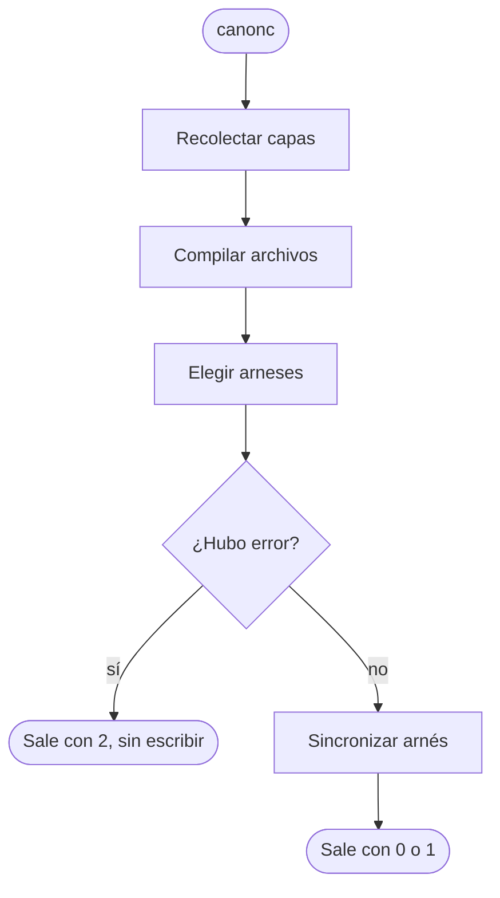

---
sources:
  - tools/cmd/canonc/main.go
  - tools/internal/canon/compile.go
  - tools/internal/canon/io.go
verified: 74eb64a
---

# Compilación del canon

> **Resumen.** El comando `canonc` toma las reglas, la configuración y las skills que escribimos a mano en dos carpetas (`.aquas-governance` y `.product-governance`), las une en un solo juego y lo escribe en `.claude/`, que es donde Claude Code lo lee. Si algo no se puede unir, no escribe nada. Con `-check` solo compara y dice si `.claude/` quedó atrás.

## Para qué sirve
Queríamos que el gobierno común y las reglas propias del producto convivan sin copiar texto a mano. Ocurrió que Claude Code solo lee una carpeta, `.claude/`. Esto significa que alguien tiene que juntar ambas fuentes y dejarlas ahí, siempre igual: eso hace `canonc`.

Ejemplo del [caso conductor](caso-conductor.md): el gobierno dice «Responde primero con el resultado» y el producto agrega «Cita el número de ticket». Tras compilar, `.claude/rules/human-communication/rules.md` trae las dos reglas, primero la del gobierno.

## Qué necesitas saber antes
Cuatro términos del [glosario](../../GLOSSARY.md), en este orden:
- [**Canon**](../../GLOSSARY.md): las reglas que se escriben a mano; lo único que se edita.
- [**Capa**](../../GLOSSARY.md): cada carpeta fuente. Hay dos, en orden: gobierno (`.aquas-governance`) y producto (`.product-governance`). La última tiene la palabra final.
- [**Sección**](../../GLOSSARY.md): la subcarpeta de una capa según su contenido: `canon`, `config` o `skills`.
- [**Arnés**](../../GLOSSARY.md): el programa que ejecuta al agente; hoy solo `claude-code`.

Esta página es una [capacidad](../../GLOSSARY.md): algo que el gobierno sabe hacer hoy.

## Cómo funciona
¿Qué pasa, de principio a fin, cuando ejecutas `canonc`? Cuatro [procesos](../../GLOSSARY.md) en fila, y una sola puerta de salida si algo falla antes de escribir:

- [Recolectar capas](recolectar-capas.md): lee cada capa y agrupa lo que cada una trae para un mismo archivo.
- [Compilar archivos](compilar-archivos.md): decide, archivo por archivo, si se copia, se une como texto o se fusiona como JSON.
- [Elegir arneses](elegir-arneses.md): lee qué arneses declara la configuración ya unida y comprueba que existan.
- [Sincronizar arnés](sincronizar-arnes.md): compara cada resultado con lo que hay en `.claude/` y escribe solo lo que cambió.

### Una sola puerta de error
Recolectar, compilar y elegir arneses ocurren en memoria. Si cualquiera falla, `canonc` sale con código 2 sin haber tocado `.claude/`. Por eso un error de tipeo en un JSON nunca deja el arnés a medio actualizar.

### Los tres códigos de salida
`main` traduce el resultado en un número que otro programa puede leer:
- `0`: todo al día (o escrito con éxito).
- `1`: solo con `-check`, algún archivo de `.claude/` está desactualizado.
- `2`: algo no se pudo leer, compilar o escribir.

El [caso conductor](caso-conductor.md) muestra los tres en una ejecución real.

## Cómo se construyó
- **Dos capas en un orden fijo** (`ef40ebe`, 2026-11-25): el gobierno escribe primero y el producto después, para que el producto pueda agregar sin borrar lo común.
- **Primer compilador** (`b61fb86`, 2026-11-26): escribía en una carpeta `dist/` que el `CLAUDE.md` importaba.
- **Un destino por arnés** (`2eed916`, 2026-11-26): se eliminó `dist/` y ahora cada arnés tiene su tabla de carpetas (`harnesses` en `compile.go`); Claude Code lee `.claude/rules` por sí solo. Las skills pasaron a copiarse intactas y a ser únicas entre capas.
- **Nombres en inglés y comentarios en cada función** (`74eb64a`, 2026-11-26): lo exige la skill `go-engineering`; las 15 pruebas de `compile_test.go` se renombraron.

Decisiones que se ven en el código:
- Todo acceso a disco pasa por `os.Root`, así ninguna ruta ni enlace simbólico puede salir de la raíz.
- La escritura es atómica: un temporal y luego un renombre, para que Claude Code nunca lea un archivo a medias.
- Los [huérfanos](../../GLOSSARY.md) se avisan y no se borran: borrar algo que nadie declaró sería irreversible.
- Un arnés desconocido es error, no se salta: saltarlo dejaría a ese arnés sin reglas sin que nadie lo note.

No hay ADR propio de esta capacidad todavía.
