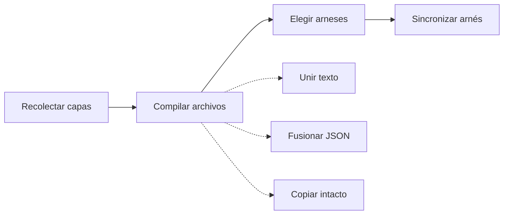
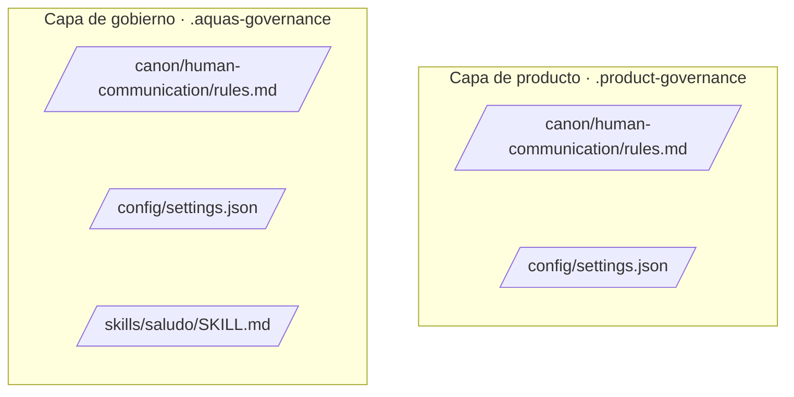
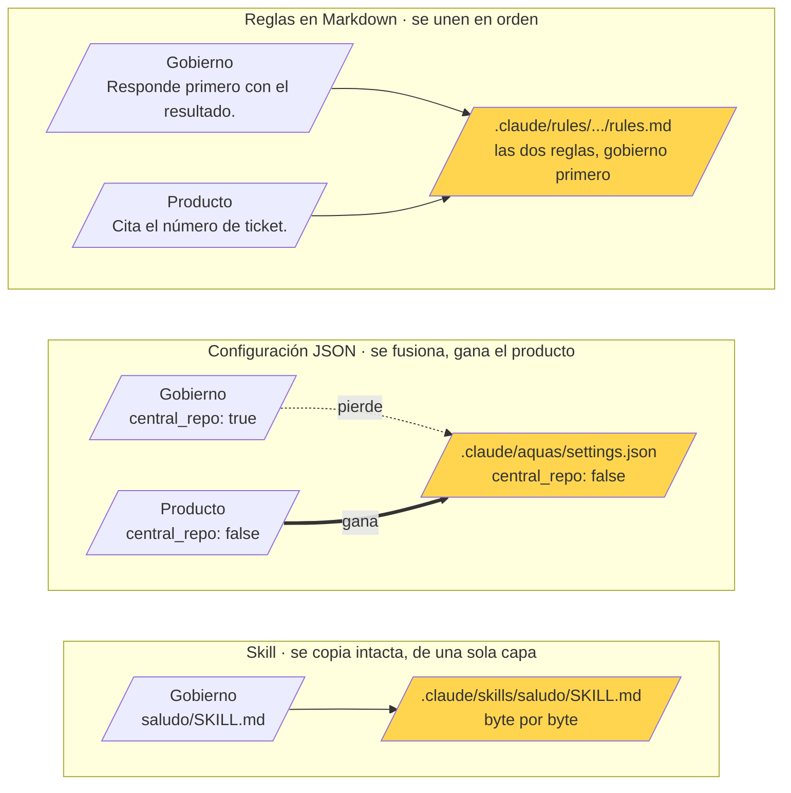
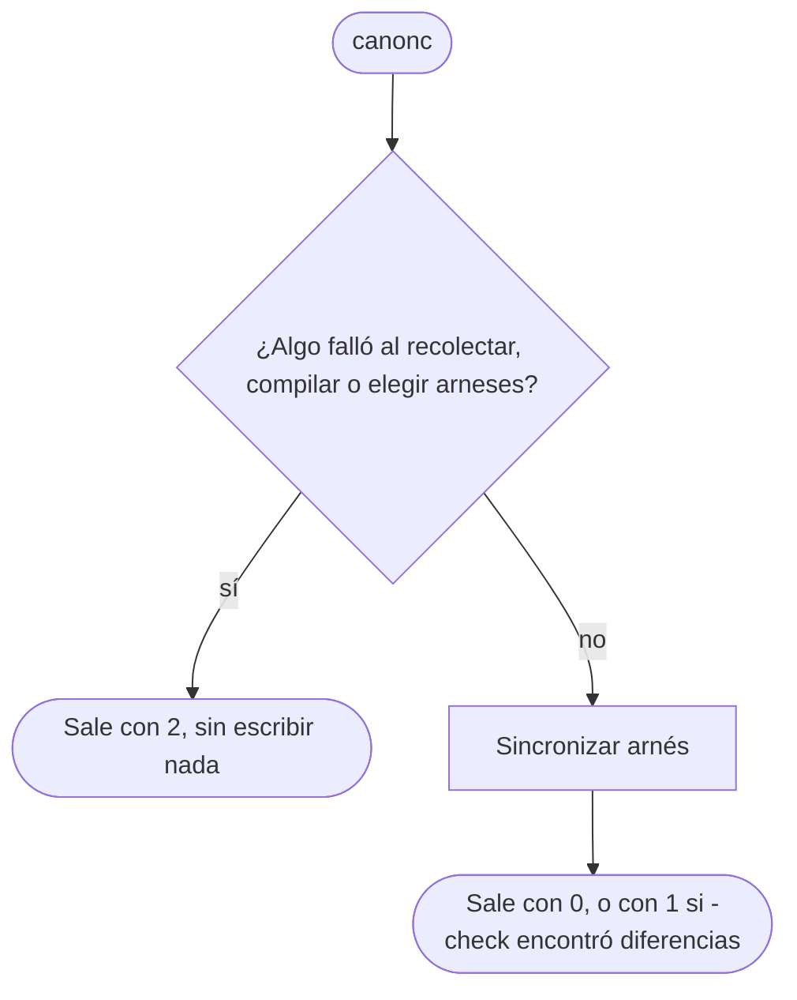
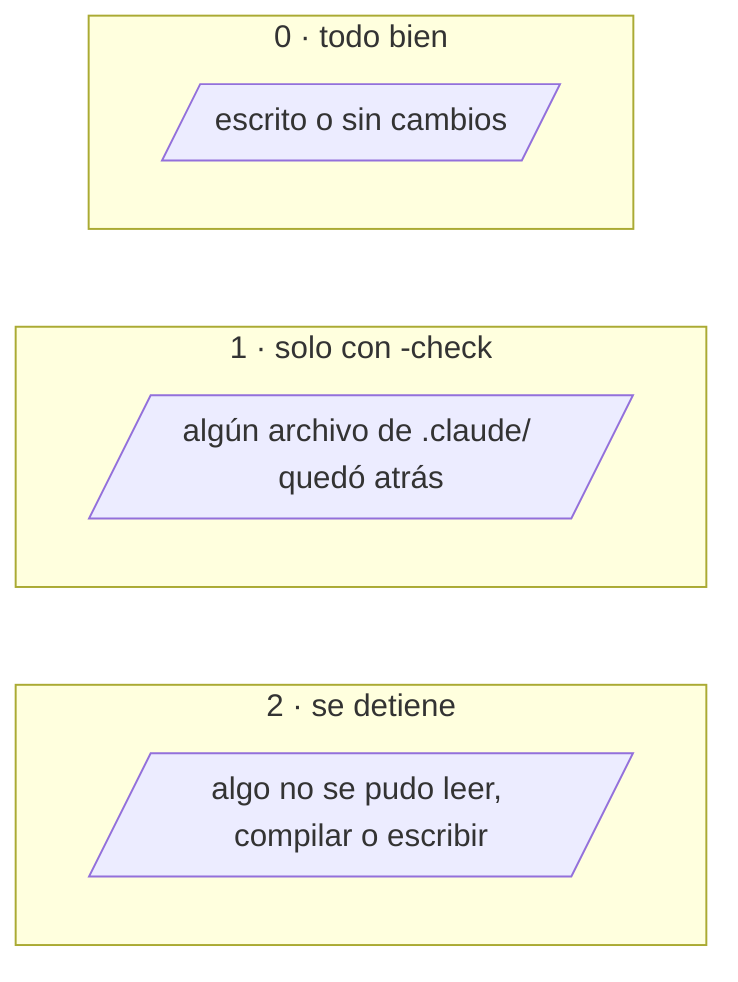
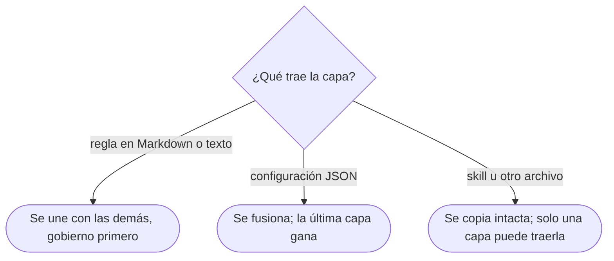
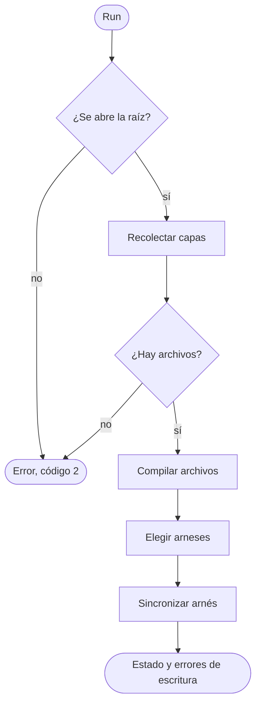

---
sources:
  - tools/cmd/canonc/main.go
  - tools/internal/canon/compile.go
  - tools/internal/canon/io.go
verified: 018d405
---

# Compilación del canon

> **En una frase.** El comando `canonc` toma las reglas (el [canon](../../GLOSSARY.md)), la configuración y las skills que escribimos a mano en cada [capa](../../GLOSSARY.md) y las deja unidas en la carpeta que lee cada [arnés](../../GLOSSARY.md): para Claude Code, `.claude/`.

## Estás aquí

Esta es la vista completa. Cada página de esta [capacidad](../../GLOSSARY.md) abre con este mismo mapa y resalta la caja que explica:



- [Recolectar capas](recolectar-capas.md): lee cada capa y agrupa lo que va al mismo archivo.
- [Compilar archivos](compilar-archivos.md): decide, archivo por archivo, cómo se combina.
- [Unir texto](unir-texto.md): pega las reglas en Markdown en orden de capa.
- [Fusionar JSON](fusionar-json.md): combina la configuración clave por clave.
- [Copiar intacto](compilar-archivos.md#copiar-intacto): deja pasar las skills sin tocarlas.
- [Elegir arneses](elegir-arneses.md): lee a qué arneses hay que escribir.
- [Sincronizar arnés](sincronizar-arnes.md): escribe en `.claude/` solo lo que cambió.

## Lo que ya sabes

El gobierno escribe reglas comunes en `.aquas-governance/` y cada producto agrega las suyas en `.product-governance/`. Claude Code no lee ninguna de las dos: solo lee `.claude/`. Sin `canonc`, alguien tendría que copiar y pegar ambas fuentes a mano cada vez, y la copia quedaría vieja sin que nadie lo note.

## Entrada

Los archivos que escribimos a mano en el [caso conductor](caso-conductor.md), por capa:



## Resultado

Cada tipo de archivo llega a `.claude/` de una forma distinta. Un bloque por tipo:



El producto escribe después que el gobierno; por eso, donde chocan, tiene la palabra final. Ejecución real del 2026-11-27, con el código del commit `018d405`:

```text
> canonc -root compilacion-del-canon
escrito         .claude/aquas/settings.json  (governance + product)
escrito         .claude/rules/human-communication/rules.md  (governance + product)
escrito         .claude/skills/saludo/SKILL.md  (governance)
código de salida: 0
```

## Primero en memoria, después en disco

`canonc` trabaja en dos tiempos. Recolecta, compila y elige arneses sin tocar el disco; solo si todo eso sale bien, sincroniza `.claude/`:



- [Sincronizar arnés](sincronizar-arnes.md): compara y escribe solo lo que cambió.

Se diseñó así para que un error de tipeo en un JSON nunca deje a Claude Code con la mitad de las reglas nuevas y la mitad viejas.

## Cuándo se detiene

`canonc` responde con un número que otro programa puede leer:



Ejecución real del paso 5 del caso conductor: la misma skill en dos capas y una clave repetida en un JSON. `canonc` muestra los dos errores juntos y no escribe nada:

```text
> canonc -root compilacion-del-canon
error: .product-governance/config/settings.json: JSON inválido: jsontext: duplicate object member name "central_repo"
skills/saludo/SKILL.md viene de varias capas (governance + product): debe existir en una sola
código de salida: 2
```

## Síntesis



Cada capa aporta su parte, `canonc` la combina según su tipo y escribe el resultado en `.claude/` solo si todo compiló. Una consecuencia directa: nunca se edita `.claude/` a mano, porque la próxima compilación lo reescribe.

## Cómo se construyó

- **Dos capas en un orden fijo** (`ef40ebe`, 2026-11-25): el gobierno escribe primero y el producto después, para que el producto pueda agregar sin borrar lo común.
- **Primer compilador** (`b61fb86`, 2026-11-26): escribía en una carpeta `dist/` que el `CLAUDE.md` importaba.
- **Un destino por arnés** (`2eed916`, 2026-11-26): se eliminó `dist/` y ahora cada arnés tiene su tabla de carpetas (`harnesses` en `compile.go`). Claude Code lee `.claude/rules` por sí solo. Las skills pasaron a copiarse intactas y a ser únicas entre capas.
- **Nombres en inglés y comentarios en cada función** (`74eb64a`, 2026-11-26): lo exige la skill `go-engineering`. Las 15 pruebas de `compile_test.go` se renombraron.

No hay ADR propio de esta capacidad todavía.

<details>
<summary><strong>Detalle completo</strong> (para quien va a cambiar el código)</summary>

**Archivos:** `tools/cmd/canonc/main.go` lee las opciones y traduce el resultado a código de salida; `tools/internal/canon/compile.go` decide; `tools/internal/canon/io.go` toca el disco.

**Opciones:** `canonc [-root carpeta] [-check]`. `-root` es la carpeta que contiene las capas (por defecto, la actual). `-check` compara sin escribir.

**Decisiones que se ven en el código**
- Todo acceso a disco pasa por `os.Root`, así ninguna ruta ni enlace simbólico puede salir de la raíz.
- La escritura es atómica: un temporal y luego un renombre, para que Claude Code nunca lea un archivo a medias.
- Los [huérfanos](../../GLOSSARY.md) se avisan y no se borran: borrar algo que nadie declaró sería irreversible.
- Un arnés desconocido es error, no se salta: saltarlo dejaría a ese arnés sin reglas sin que nadie lo note.
- Límite conocido: un error de escritura a mitad de la sincronización sí puede dejar algunos archivos nuevos y otros viejos. La garantía de «no escribe nada» cubre lo que ocurre en memoria.

**Recorrido completo de `Run`**



- [Recolectar capas](recolectar-capas.md): `collect`.
- [Compilar archivos](compilar-archivos.md): `buildAll`.
- [Elegir arneses](elegir-arneses.md): `harnessNames`.
- [Sincronizar arnés](sincronizar-arnes.md): `sync`, una vez por arnés.

</details>

**Siguiente:** [Caso conductor](caso-conductor.md). Todos los pasos ejecutados, con su salida real.
