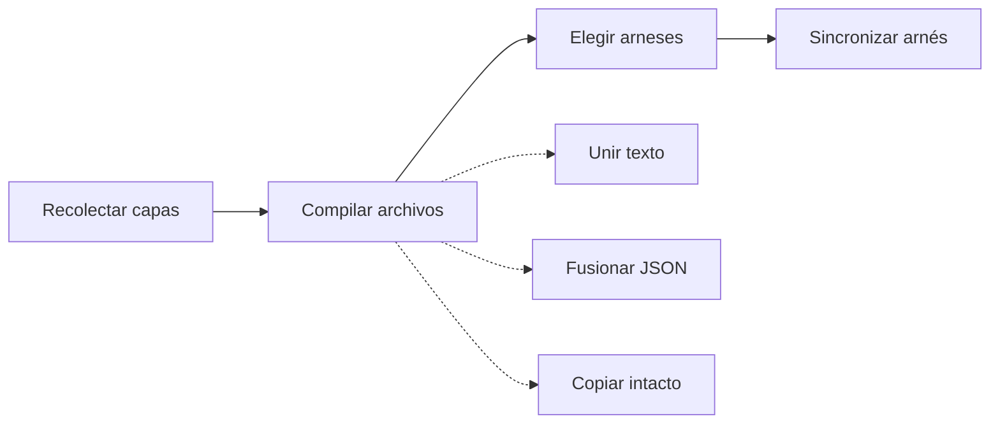
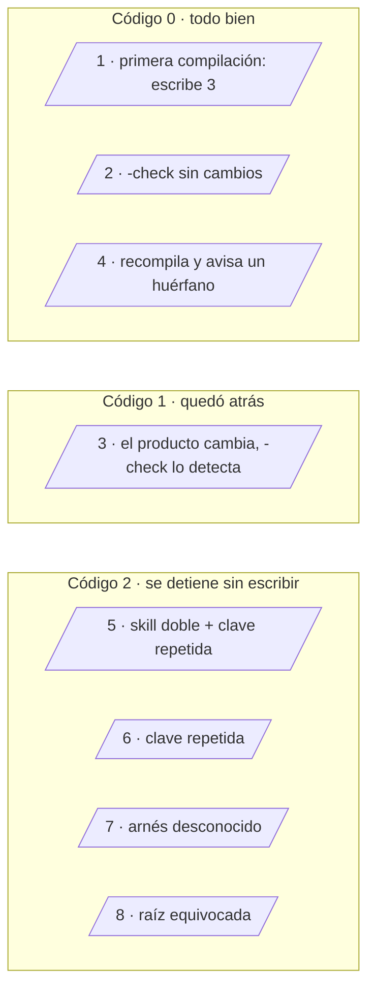
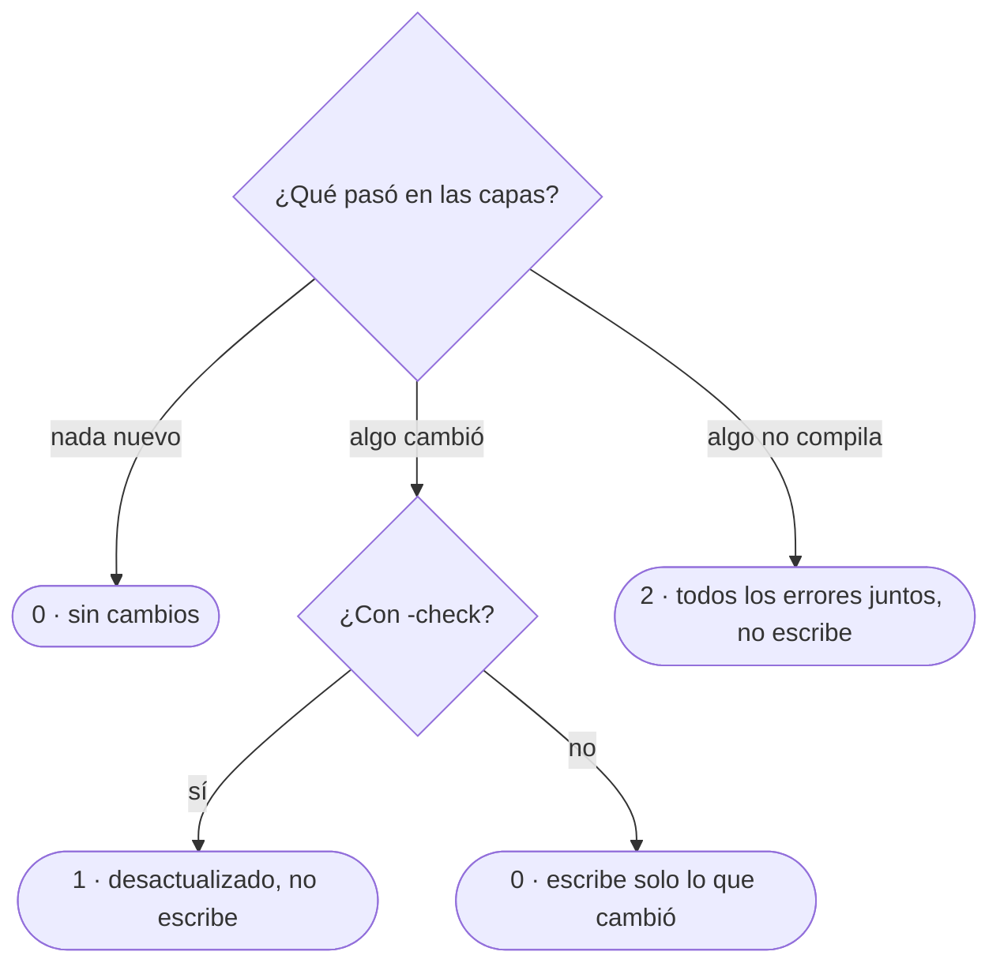

---
sources:
  - tools/cmd/canonc/main.go
  - tools/internal/canon/compile.go
  - tools/internal/canon/io.go
verified: 018d405
---

# Caso conductor: una regla de producto llega a Claude Code

> **En una frase.** Un repositorio de prueba con dos [capas](../../GLOSSARY.md), compilado nueve veces con `canonc` para mostrar cada resultado real que puede ver un [arnés](../../GLOSSARY.md): escribir, no cambiar nada, quedar atrás, avisar y detenerse.

## Estás aquí

Este es el [caso conductor](../../GLOSSARY.md) de la [Compilación del canon](README.md). Recorre todo el mapa; cada página de [proceso](../../GLOSSARY.md) toma de aquí su entrada y su resultado. En el paso 4 aparece un [huérfano](../../GLOSSARY.md): un archivo de `.claude/` que ninguna capa produce.



- [Recolectar capas](recolectar-capas.md): pasos 1 y 8.
- [Compilar archivos](compilar-archivos.md): pasos 1 y 5.
- [Unir texto](unir-texto.md): pasos 1 y 4.
- [Fusionar JSON](fusionar-json.md): pasos 1 y 6.
- [Copiar intacto](compilar-archivos.md#copiar-intacto): pasos 1 y 5.
- [Elegir arneses](elegir-arneses.md): paso 7.
- [Sincronizar arnés](sincronizar-arnes.md): pasos 2, 3 y 4.

## Lo que ya sabes

La [página principal](README.md) explica que `canonc` une lo que trae cada capa y lo deja en `.claude/`. Aquí se ve con archivos concretos, en el orden en que alguien los tocaría en un día normal de trabajo.

Ejecución real: 2026-11-27, en `product/.tmp/compilacion-del-canon/`, con el binario compilado del commit `018d405`. Se usa el binario y no `go run` porque `go run` cambia el código de salida 2 por 1.

## Entrada

Seis archivos escritos a mano. El de producto trae a propósito la marca BOM y saltos de línea de Windows (`\r\n`), y hay un archivo oculto que debe ignorarse:

```text
.aquas-governance/canon/human-communication/rules.md
  # Comunicación
  - Responde primero con el resultado.

.aquas-governance/canon/.borrador.md            (oculto: empieza con punto)
  nota del editor, no es una regla

.product-governance/canon/human-communication/rules.md   (con BOM y \r\n)
  # Comunicación del producto
  - Cita el número de ticket.

.aquas-governance/config/settings.json
  { "harness": ["claude-code"], "shell": "powershell", "central_repo": true,
    "paths": { "root": ".", "product": "product" }, "tags": ["gobierno"] }

.product-governance/config/settings.json
  { "central_repo": false, "paths": { "product": "app" }, "tags": ["producto"] }

.aquas-governance/skills/saludo/SKILL.md
  ---
  name: saludo
  description: Saluda.
  ---
  Di hola.
```

## Resultado

Los nueve pasos y el código con que terminó cada uno:



### Paso 1: primera compilación

```text
> canonc -root compilacion-del-canon
escrito         .claude/aquas/settings.json  (governance + product)
escrito         .claude/rules/human-communication/rules.md  (governance + product)
escrito         .claude/skills/saludo/SKILL.md  (governance)
código de salida: 0
```

`.borrador.md` no aparece: se ignoró. Las reglas quedaron así, sin BOM y solo con `\n`; una línea en blanco separa cada [aporte](../../GLOSSARY.md):

```markdown
<!-- Generado por canonc desde .aquas-governance/canon/human-communication/rules.md + .product-governance/canon/human-communication/rules.md. No editar aquí: edita las fuentes. -->

# Comunicación
- Responde primero con el resultado.

# Comunicación del producto
- Cita el número de ticket.
```

La configuración quedó con las claves en orden alfabético:

```json
{
  "central_repo": false,
  "harness": [
    "claude-code"
  ],
  "paths": {
    "product": "app",
    "root": "."
  },
  "shell": "powershell",
  "tags": [
    "producto"
  ]
}
```

### Paso 2: comprobar sin cambios

```text
> canonc -root compilacion-del-canon -check
sin cambios     .claude/aquas/settings.json
sin cambios     .claude/rules/human-communication/rules.md
sin cambios     .claude/skills/saludo/SKILL.md
código de salida: 0
```

### Paso 3: el producto agrega una regla

Se agrega `- Usa fechas ISO 8601.` a la regla del producto, sin recompilar:

```text
> canonc -root compilacion-del-canon -check
sin cambios     .claude/aquas/settings.json
desactualizado  .claude/rules/human-communication/rules.md
sin cambios     .claude/skills/saludo/SKILL.md
el arnés está desactualizado: ejecuta canonc sin -check
código de salida: 1
```

### Paso 4: recompilar con un archivo que nadie declaró

Se deja a mano `.claude/rules/viejo.md` y se compila:

```text
> canonc -root compilacion-del-canon
sin cambios     .claude/aquas/settings.json
escrito         .claude/rules/human-communication/rules.md  (governance + product)
sin cambios     .claude/skills/saludo/SKILL.md
aviso: .claude/rules/viejo.md no viene de ninguna capa; revísalo o bórralo
código de salida: 0
```

Solo se reescribió el archivo que cambió. `viejo.md` es el huérfano: se avisa y se deja donde está.

### Paso 5: la misma skill en dos capas y una clave repetida

Se copia `saludo/SKILL.md` también a la capa de producto y se escribe `central_repo` dos veces en el JSON del producto:

```text
> canonc -root compilacion-del-canon
error: .product-governance/config/settings.json: JSON inválido: jsontext: duplicate object member name "central_repo"
skills/saludo/SKILL.md viene de varias capas (governance + product): debe existir en una sola
código de salida: 2
```

Los dos errores salen juntos y no se escribe ningún archivo, tampoco los que sí compilaban.

### Paso 6: solo la clave repetida

Se quita la skill duplicada:

```text
> canonc -root compilacion-del-canon
error: .product-governance/config/settings.json: JSON inválido: jsontext: duplicate object member name "central_repo"
código de salida: 2
```

### Paso 7: un arnés mal escrito

El JSON del producto declara `"harness": ["claude_code"]`, con guion bajo:

```text
> canonc -root compilacion-del-canon
error: config/settings.json: el arnés "claude_code" no está soportado (soportados: claude-code)
código de salida: 2
```

### Paso 8: la raíz equivocada

```text
> canonc -root vacio
error: no encontré archivos en "vacio": revisa -root
código de salida: 2
```

## Síntesis



Con el JSON del producto restaurado, el paso 9 (`-check`) volvió a dar código 0 y repitió el aviso de `viejo.md`. Una consecuencia directa: `canonc -check` sirve como prueba automática antes de un commit, porque solo sale con 0 cuando `.claude/` está al día.

**Siguiente:** [Recolectar capas](recolectar-capas.md). La primera caja del mapa, con los archivos de este caso.
