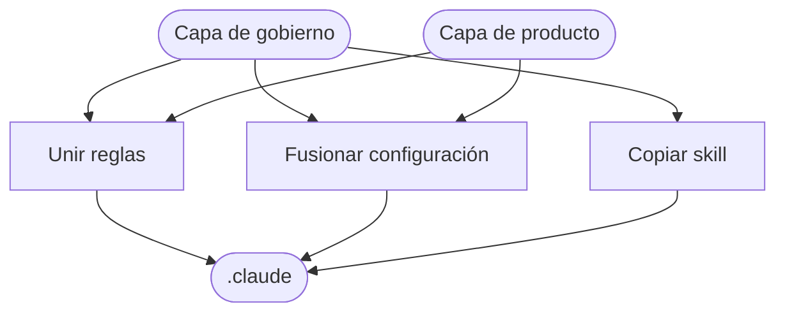

---
sources:
  - tools/cmd/canonc/main.go
  - tools/internal/canon/compile.go
  - tools/internal/canon/io.go
verified: 74eb64a
---

# Caso conductor: una regla de producto llega a Claude Code

> **Resumen.** Armamos un repositorio de prueba con una regla del gobierno, una regla del producto, dos configuraciones y una skill. Ejecutamos `canonc` cinco veces y mostramos cada salida real. Este mismo caso aparece en todas las páginas de la [Compilación del canon](README.md).

Ejecución real: 2026-11-26 (hora de Venezuela), en `product/.tmp/compilacion-del-canon/`, con el código del commit `74eb64a`. Este es el [caso conductor](../../GLOSSARY.md) de la [capacidad](../../GLOSSARY.md).

## Para qué sirve
Ver con datos concretos lo que la página principal explica en abstracto: qué entra, qué sale y qué número devuelve `canonc` en cada situación.

## Qué necesitas saber antes
- [Compilación del canon](README.md): el resumen y los cuatro términos de su apartado «Qué necesitas saber antes».

## Cómo funciona
¿Qué archivos tiene el repositorio de prueba y adónde va cada uno? Cada [capa](../../GLOSSARY.md) trae sus archivos; todo termina en `.claude/`:



- [Unir reglas](#paso-1-primera-compilación): las dos `rules.md` se vuelven una.
- [Fusionar configuración](#paso-1-primera-compilación): los dos `settings.json` se vuelven uno.
- [Copiar skill](#paso-1-primera-compilación): `saludo/SKILL.md` llega intacta.

### Los archivos de entrada
```text
.aquas-governance/canon/human-communication/rules.md
  # Comunicación
  - Responde primero con el resultado.

.product-governance/canon/human-communication/rules.md
  # Comunicación del producto
  - Cita el número de ticket.

.aquas-governance/config/settings.json
  { "harness": ["claude-code"], "shell": "powershell", "central_repo": true }

.product-governance/config/settings.json
  { "central_repo": false }

.aquas-governance/skills/saludo/SKILL.md
  (una skill mínima que dice «Di hola.»)
```

### Paso 1: primera compilación
```text
> go run ./tools/cmd/canonc -root product/.tmp/compilacion-del-canon
escrito         .claude/aquas/settings.json  (governance + product)
escrito         .claude/rules/human-communication/rules.md  (governance + product)
escrito         .claude/skills/saludo/SKILL.md  (governance)
código de salida: 0
```

El archivo de reglas quedó así; la regla del gobierno va primero y una línea en blanco separa cada [aporte](../../GLOSSARY.md):

```markdown
<!-- Generado por canonc desde .aquas-governance/canon/human-communication/rules.md + .product-governance/canon/human-communication/rules.md. No editar aquí: edita las fuentes. -->

# Comunicación
- Responde primero con el resultado.

# Comunicación del producto
- Cita el número de ticket.
```

La configuración quedó así: las claves van ordenadas y `central_repo` vale `false`, porque el producto escribe después y gana:

```json
{
  "central_repo": false,
  "harness": [
    "claude-code"
  ],
  "shell": "powershell"
}
```

### Paso 2: comprobar sin cambios
```text
> go run ./tools/cmd/canonc -root product/.tmp/compilacion-del-canon -check
sin cambios     .claude/aquas/settings.json
sin cambios     .claude/rules/human-communication/rules.md
sin cambios     .claude/skills/saludo/SKILL.md
código de salida: 0
```

### Paso 3: el producto agrega una regla y comprobamos
Agregamos «- Usa fechas ISO 8601.» a la regla del producto, sin recompilar:

```text
> go run ./tools/cmd/canonc -root product/.tmp/compilacion-del-canon -check
sin cambios     .claude/aquas/settings.json
desactualizado  .claude/rules/human-communication/rules.md
sin cambios     .claude/skills/saludo/SKILL.md
el arnés está desactualizado: ejecuta canonc sin -check
exit status 1
código de salida: 1
```

La línea `exit status 1` la imprime `go run`, no `canonc`. Nada se escribió.

### Paso 4: recompilar con un archivo que nadie declaró
Dejamos a mano `.claude/rules/viejo.md` y compilamos:

```text
> go run ./tools/cmd/canonc -root product/.tmp/compilacion-del-canon
sin cambios     .claude/aquas/settings.json
escrito         .claude/rules/human-communication/rules.md  (governance + product)
sin cambios     .claude/skills/saludo/SKILL.md
aviso: .claude/rules/viejo.md no viene de ninguna capa; revísalo o bórralo
código de salida: 0
```

Solo se reescribió el archivo que cambió. `viejo.md` es un [huérfano](../../GLOSSARY.md): se avisa y se deja donde está.

### Paso 5: la misma skill en dos capas
Copiamos `saludo/SKILL.md` también a la capa de producto. Esta vez con el binario compilado, para ver el código real:

```text
> product/.tmp/bin/canonc.exe -root product/.tmp/compilacion-del-canon
error: skills/saludo/SKILL.md viene de varias capas (governance + product): debe existir en una sola
código de salida: 2
```

No se escribió ningún archivo, tampoco los que sí compilaban.
