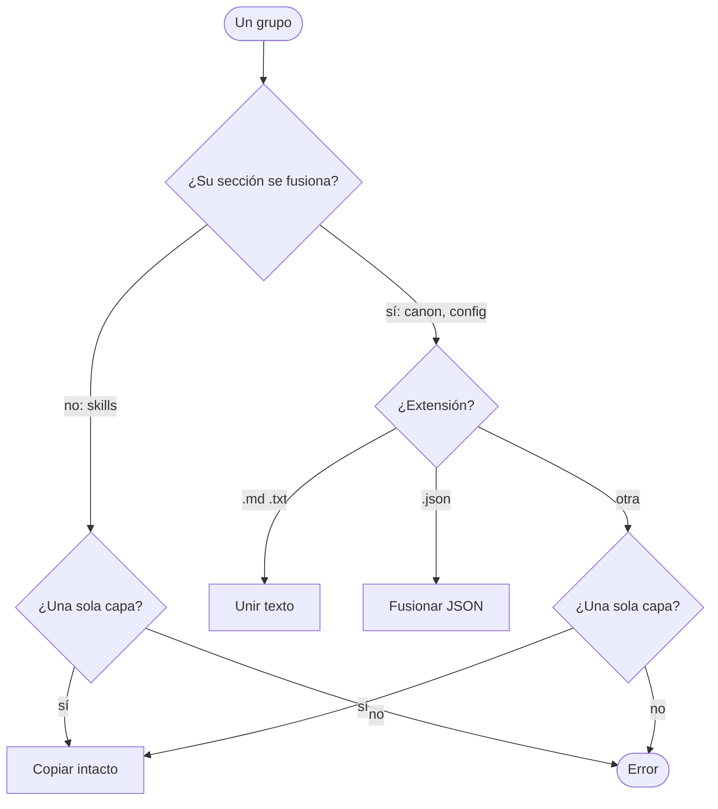

---
sources:
  - tools/internal/canon/compile.go
verified: 74eb64a
---

# Compilar archivos

> **Resumen.** Segundo [proceso](../../GLOSSARY.md) de la [Compilación del canon](README.md). Toma cada grupo de [aportes](../../GLOSSARY.md) y produce los bytes finales: copia, une como texto o fusiona como JSON, según la [sección](../../GLOSSARY.md) y la extensión. Reúne todos los errores y los muestra juntos. Funciones: `buildAll` y `build` en `compile.go`.

## Para qué sirve
En el [caso conductor](caso-conductor.md) hay tres grupos: reglas en Markdown, configuración en JSON y una skill. Cada uno se combina de forma distinta: no se puede pegar un JSON debajo de otro, ni partir una skill en dos.

## Qué necesitas saber antes
- [Recolectar capas](recolectar-capas.md): de ahí salen los grupos de aportes.

## Cómo funciona
¿Cómo se decide qué hacer con cada grupo? Primero según su [sección](../../GLOSSARY.md), después según la extensión del archivo:

- [Copiar intacto](#copiar-intacto): el archivo pasa sin cambios.
- [Unir texto](unir-texto.md): los aportes se concatenan en orden.
- [Fusionar JSON](fusionar-json.md): los objetos se combinan clave por clave.

### Copiar intacto
¿Cuándo no se combina nada? En dos casos: las skills siempre, y cualquier archivo con una extensión que no sea `.md`, `.txt` ni `.json`. En ambos se exige que una sola capa traiga el archivo. Una skill no se puede pegar con otra sin romper su cabecera; por eso `skills` es la única sección que no se fusiona.

En el caso conductor, `saludo/SKILL.md` llega a `.claude/skills/` byte por byte. En el paso 5, la misma skill en dos capas da el error «viene de varias capas».

### Todos los errores juntos
`buildAll` compila todos los grupos aunque alguno falle, y devuelve la lista completa de errores. Queríamos que un humano corrija todo de una vez; ocurría que el primer error ocultaba a los demás; esto significa una sola ronda de correcciones en lugar de varias.

Siguiente proceso: [Elegir arneses](elegir-arneses.md).
