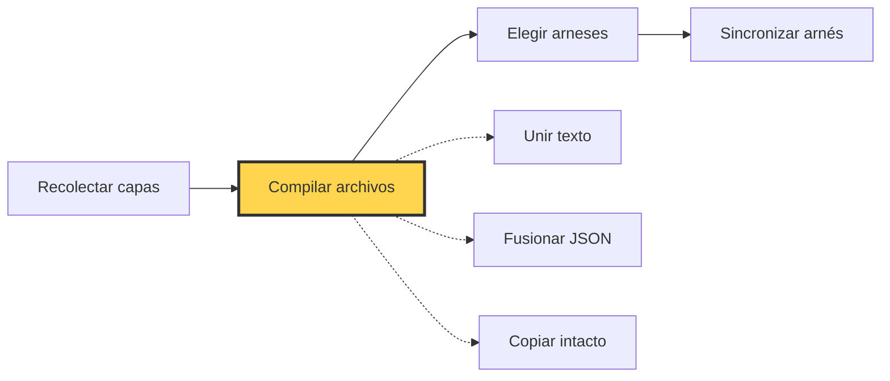
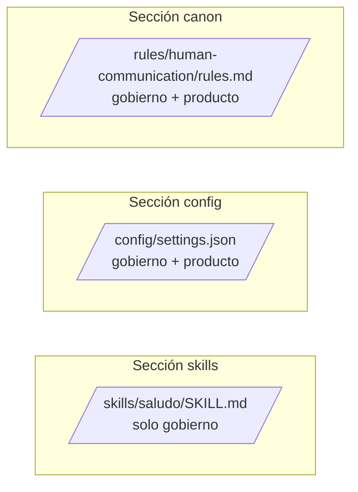
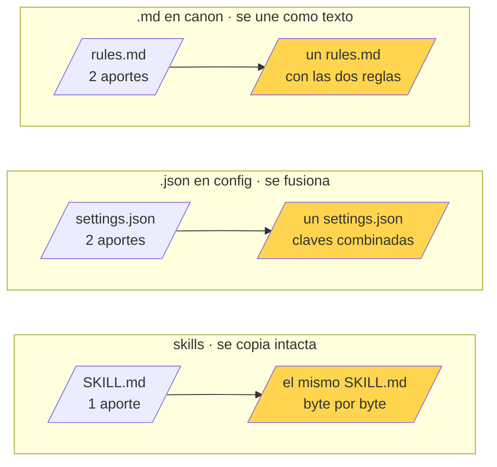
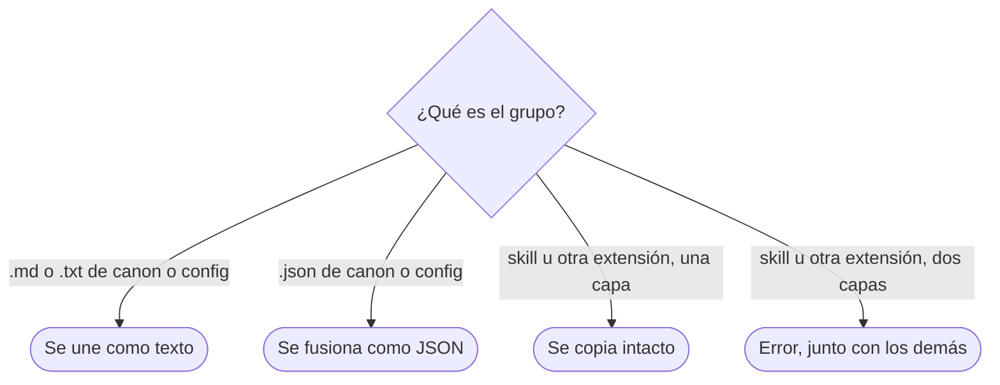

---
sources:
  - tools/internal/canon/compile.go
verified: 018d405
---

# Compilar archivos

> **En una frase.** `canonc` toma cada grupo de [aportes](../../GLOSSARY.md) que trajeron las [capas](../../GLOSSARY.md) y produce el contenido final que recibirá cada [arnés](../../GLOSSARY.md): lo une como texto, lo fusiona como JSON o lo copia intacto, según su [sección](../../GLOSSARY.md) y su extensión.

## Estás aquí



- [Recolectar capas](recolectar-capas.md): de ahí salen los grupos.
- [Compilar archivos](compilar-archivos.md): esta página.
- [Unir texto](unir-texto.md): una de las tres salidas de esta caja.
- [Fusionar JSON](fusionar-json.md): otra de las tres salidas.
- [Copiar intacto](#copiar-intacto): la tercera, explicada aquí mismo.
- [Elegir arneses](elegir-arneses.md): usa la configuración ya compilada.
- [Sincronizar arnés](sincronizar-arnes.md): escribe el resultado.

## Lo que ya sabes

[Recolectar capas](recolectar-capas.md) dejó tres grupos en orden de capa: las reglas del [canon](../../GLOSSARY.md), la configuración y una skill. No se pueden tratar igual: pegar un JSON debajo de otro da un JSON roto, y partir una skill en dos rompe su cabecera.

## Entrada

Los tres grupos del [caso conductor](caso-conductor.md):



## Resultado

Cada grupo sale por un camino distinto:



Todo ocurre en memoria: esta caja todavía no escribe en disco. El paso 1 del caso conductor muestra los tres archivos ya escritos.

## Elegir cómo combinar

`canonc` decide primero por la sección y después por la extensión:


- [Copiar intacto](#copiar-intacto): el archivo pasa sin cambios.
- [Unir texto](unir-texto.md): los aportes se pegan en orden.
- [Fusionar JSON](fusionar-json.md): los objetos se combinan clave por clave.

Se diseñó así porque la sección dice qué se puede combinar y la extensión dice cómo.

### Copiar intacto

Las skills siempre se copian intactas, y también cualquier archivo de `canon` o `config` cuya extensión no sea `.md`, `.txt` ni `.json`. En los dos casos se exige que una sola capa traiga el archivo, porque no hay forma segura de combinarlo. Es una **[hoja](../../GLOSSARY.md)**: una sola regla, sin más pasos. En el caso conductor, `saludo/SKILL.md` llega a `.claude/skills/` byte por byte.

## Cuándo se detiene

Si un grupo no se puede compilar, `canonc` sigue con los demás y al final muestra **todos** los errores juntos, con código 2. Paso 5 del caso conductor, con dos errores a la vez:

```text
> canonc -root compilacion-del-canon
error: .product-governance/config/settings.json: JSON inválido: jsontext: duplicate object member name "central_repo"
skills/saludo/SKILL.md viene de varias capas (governance + product): debe existir en una sola
código de salida: 2
```

Queríamos que quien corrige lo haga en una sola ronda; si `canonc` parara en el primer error, el segundo solo aparecería después de arreglar el primero.

## Síntesis



La sección decide si se combina y la extensión decide cómo. Una consecuencia directa: una skill no se puede extender desde el producto; para cambiarla hay que editarla en la capa donde vive.

<details>
<summary><strong>Detalle completo</strong> (para quien va a cambiar el código)</summary>

**Funciones:** `buildAll` y `build` en `tools/internal/canon/compile.go`.

- `buildAll` recorre los grupos en orden alfabético de clave y acumula los errores con `errors.Join`.
- `build` mira `merge` (de la tabla `sections`): `false` solo en `skills`.
- El mensaje de «viene de varias capas» nombra las capas en orden con `layerNames`.
- Para una extensión desconocida en dos capas, el mensaje es «no sé combinar archivos ".x" de varias capas».

</details>

**Siguiente:** [Unir texto](unir-texto.md). Lo que le pasa al grupo de reglas.
