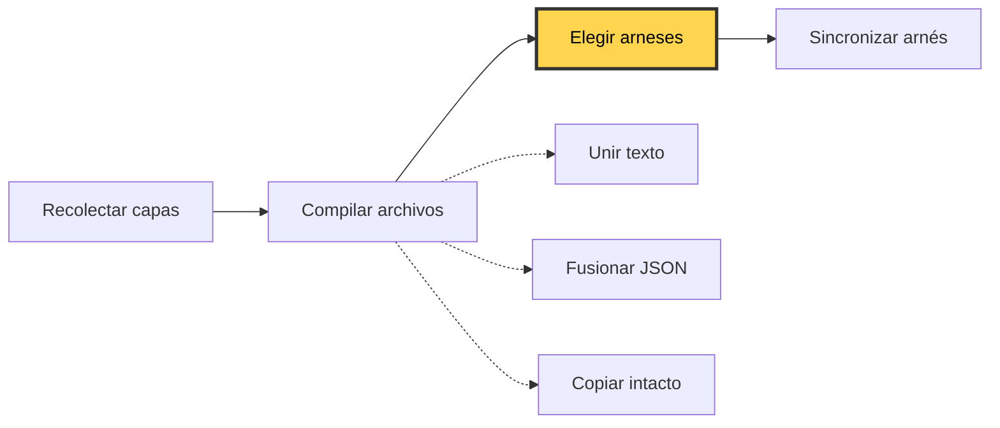
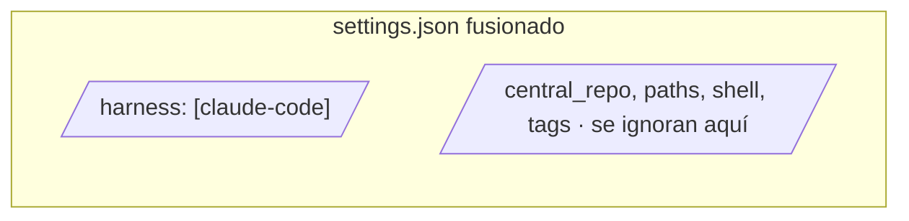
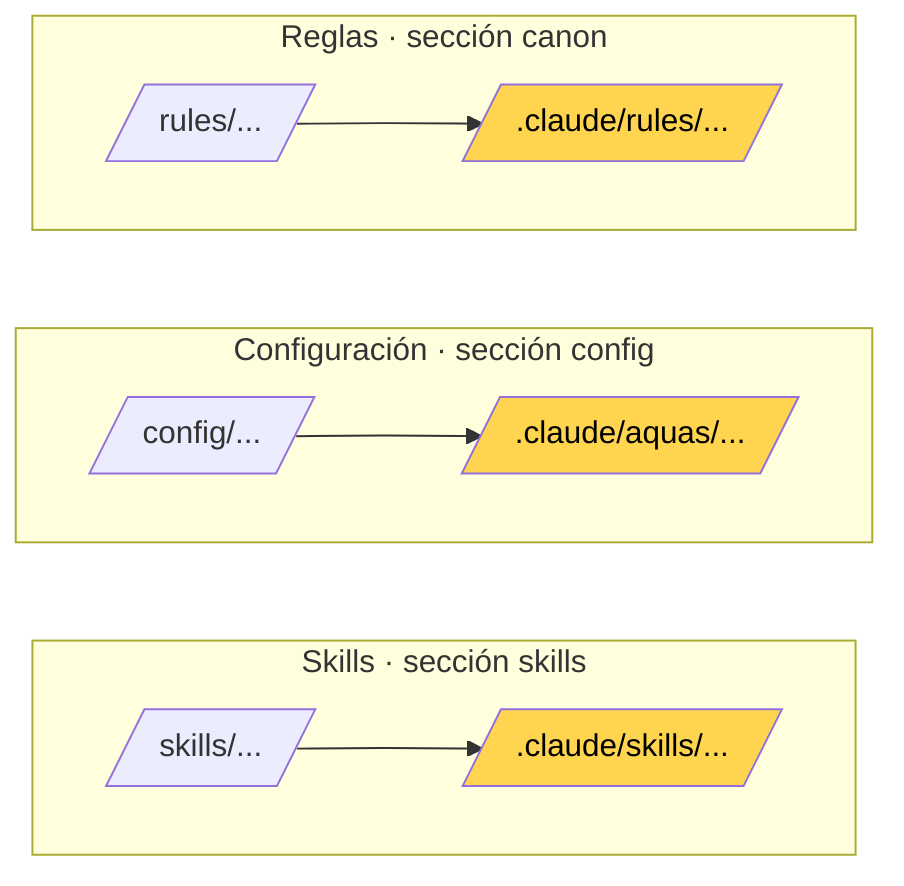
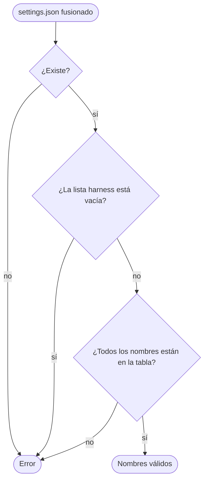
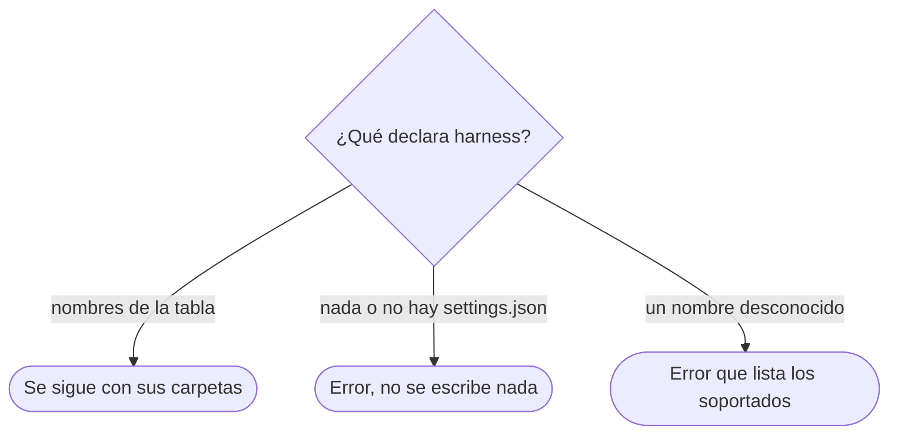

---
sources:
  - tools/internal/canon/compile.go
  - tools/internal/canon/io.go
verified: 018d405
---

# Elegir arneses

> **En una frase.** `canonc` lee la lista `harness` del `settings.json` ya fusionado y comprueba que conoce las carpetas de cada [arnés](../../GLOSSARY.md), sin importar qué [capa](../../GLOSSARY.md) lo declaró; si un nombre no existe, se detiene en vez de saltarlo.

## Estás aquí



- [Recolectar capas](recolectar-capas.md): arma los grupos.
- [Compilar archivos](compilar-archivos.md): produce el contenido de cada archivo.
- [Unir texto](unir-texto.md): reglas en Markdown.
- [Fusionar JSON](fusionar-json.md): produce el JSON que se lee aquí.
- [Copiar intacto](compilar-archivos.md#copiar-intacto): skills.
- [Elegir arneses](elegir-arneses.md): esta página.
- [Sincronizar arnés](sincronizar-arnes.md): usa las carpetas que salen de aquí.

## Lo que ya sabes

[Fusionar JSON](fusionar-json.md) dejó en memoria un solo `settings.json`, con [aportes](../../GLOSSARY.md) de las dos capas. Todavía no se sabe a qué carpetas escribir: eso depende de qué programa va a leer las reglas.

## Entrada

Del JSON fusionado del [caso conductor](caso-conductor.md) solo importa una clave:



## Resultado

Cada nombre de la lista se busca en la tabla `harnesses`. Para `claude-code`, cada [sección](../../GLOSSARY.md) tiene su carpeta; las reglas del [canon](../../GLOSSARY.md) van a `.claude/rules`:



La configuración va a `.claude/aquas/` y no a `.claude/settings.json`, porque ese archivo es la configuración propia de Claude Code y `canonc` no lo toca.

## Tabla de arneses

Cada arnés soportado es una fila de la tabla **`harnesses`** en `compile.go`. Hoy tiene una sola fila, `claude-code`. Antes de aceptar la lista, `canonc` hace tres comprobaciones en fila:



Se diseñó así para que soportar otro arnés sea agregar una fila a la tabla, sin cambiar la lógica.

## Cuándo se detiene

Un nombre desconocido es error, no se salta. Si se saltara, ese arnés se quedaría sin reglas y nadie lo notaría. Paso 7 del caso conductor, con un guion bajo en vez de guion:

```text
> canonc -root compilacion-del-canon
error: config/settings.json: el arnés "claude_code" no está soportado (soportados: claude-code)
código de salida: 2
```

El producto declaró `"harness": ["claude_code"]` y su lista reemplazó entera la del gobierno, como explica [Fusionar JSON](fusionar-json.md). El mensaje nombra los arneses que sí existen.

## Síntesis



La lista `harness` dice a quién escribir y la tabla `harnesses` dice dónde. Una consecuencia directa: un tipeo en `harness` detiene la compilación entera, en lugar de dejar reglas viejas en silencio.

<details>
<summary><strong>Detalle completo</strong> (para quien va a cambiar el código)</summary>

**Funciones:** `harnessNames` en `tools/internal/canon/compile.go` y `decodeHarness` en `tools/internal/canon/io.go`.

- La clave que se busca es `config/settings.json` (`settingsKey`), ya compilada.
- `decodeHarness` lee solo `harness` como lista de textos e ignora el resto de claves.
- Los tres mensajes de error: «falta config/settings.json en las capas», «no declara ningún arnés en «harness»» y «el arnés "x" no está soportado (soportados: …)».
- `Run` llama a `sync` una vez por cada nombre de la lista, en el orden declarado.

</details>

**Siguiente:** [Sincronizar arnés](sincronizar-arnes.md). Escribe en estas carpetas solo lo que cambió.
