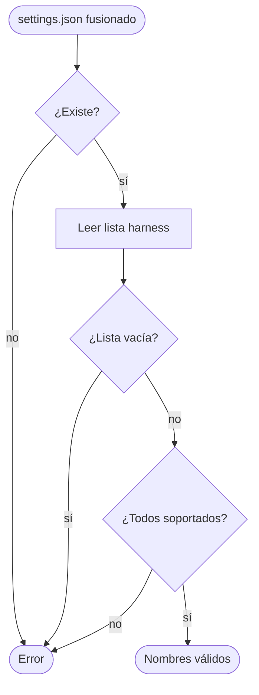

---
sources:
  - tools/internal/canon/compile.go
  - tools/internal/canon/io.go
verified: 74eb64a
---

# Elegir arneses

> **Resumen.** Tercer [proceso](../../GLOSSARY.md) de la [Compilación del canon](README.md). Lee la lista `harness` de la configuración ya fusionada y comprueba que cada [arnés](../../GLOSSARY.md) tenga carpetas de destino conocidas. Un arnés desconocido es error, no se salta. Funciones: `harnessNames` en `compile.go` y `decodeHarness` en `io.go`.

## Para qué sirve
En el [caso conductor](caso-conductor.md), la configuración declara `"harness": ["claude-code"]`. Antes de escribir hay que saber a qué carpetas va cada cosa para ese arnés: reglas a `.claude/rules`, skills a `.claude/skills` y configuración a `.claude/aquas`.

## Qué necesitas saber antes
- [Fusionar JSON](fusionar-json.md): la lista se lee del `settings.json` ya fusionado, no del de una sola [capa](../../GLOSSARY.md).

## Cómo funciona
¿Cuándo se puede seguir y cuándo hay que parar? Tres comprobaciones en fila; cualquiera que falle detiene todo antes de escribir:

- [Leer lista harness](#leer-lista-harness): extrae solo la clave `harness`.

### Leer lista harness
¿Qué se lee del archivo? Solo `harness`, una lista de nombres; el resto de claves se ignora aquí. Cada nombre se busca en la tabla `harnesses` de `compile.go`, que hoy tiene una fila: `claude-code`. Soportar otro arnés es agregar una fila a esa tabla; la lógica no cambia.

¿Por qué un nombre desconocido es error y no se salta? Queríamos detectar un tipeo como `"claude_code"`; ocurriría que, al saltarlo, ese arnés se quedaría sin reglas y nadie lo notaría; esto significa que preferimos parar con un mensaje que nombra los arneses soportados.

Siguiente proceso: [Sincronizar arnés](sincronizar-arnes.md).
