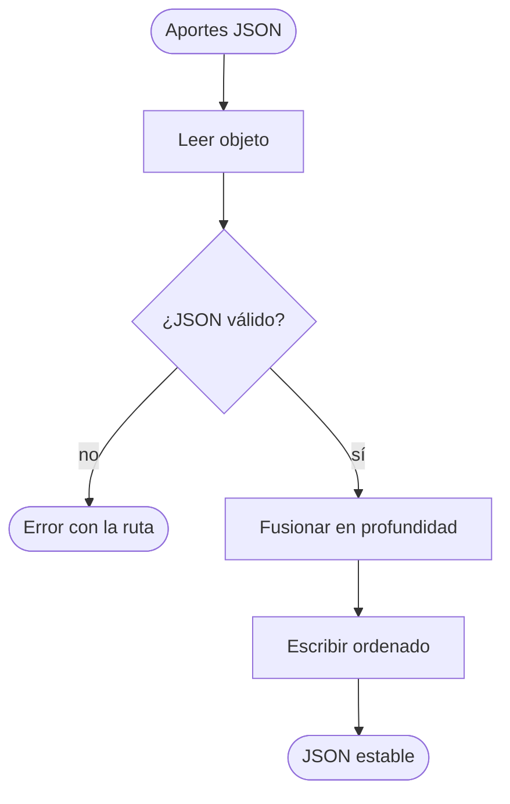
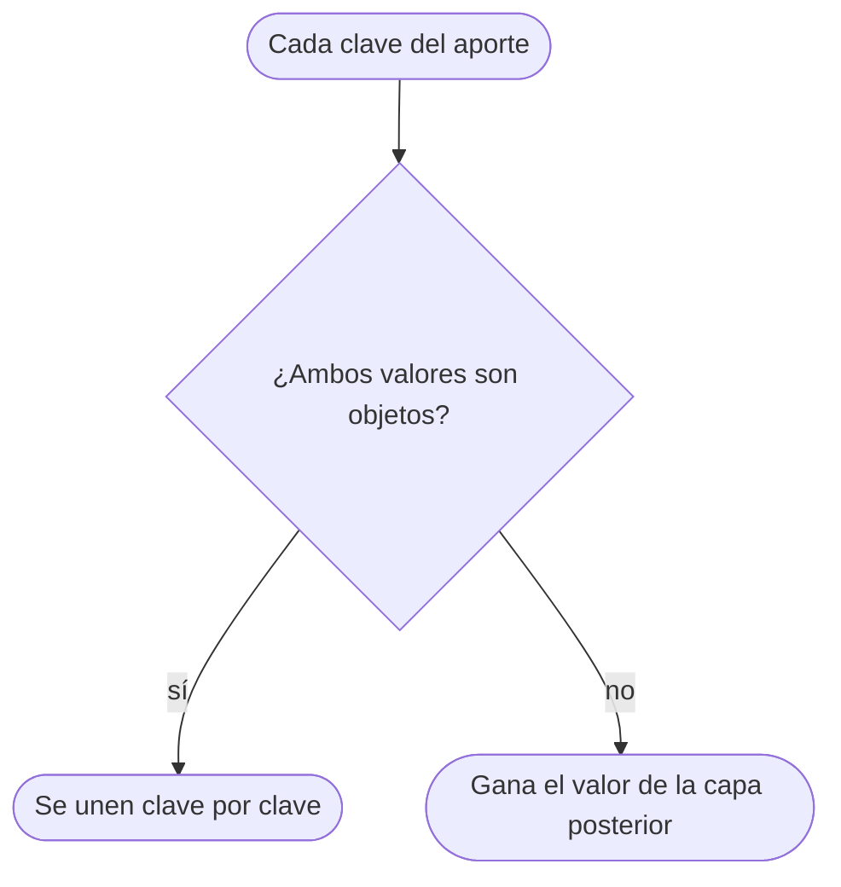

---
sources:
  - tools/internal/canon/compile.go
  - tools/internal/canon/io.go
verified: 74eb64a
---

# Fusionar JSON

> **Resumen.** Parte de [Compilar archivos](compilar-archivos.md). Lee el objeto JSON que trae cada [capa](../../GLOSSARY.md) como [aporte](../../GLOSSARY.md), los combina clave por clave en orden (la capa posterior gana) y escribe el resultado con claves ordenadas, para que la misma entrada dé siempre los mismos bytes. Funciones: `mergeJSON` y `deepMerge` en `compile.go`; `decodeObject` y `encodeObject` en `io.go`.

## Para qué sirve
En el [caso conductor](caso-conductor.md), el gobierno declara `"central_repo": true` y el producto `"central_repo": false`. El resultado debe tener las claves de ambos y, donde chocan, el valor del producto.

## Qué necesitas saber antes
- [Compilar archivos](compilar-archivos.md): por qué este grupo llegó aquí.
- El orden de las [capas](../../GLOSSARY.md): gobierno primero, producto después.

## Cómo funciona
¿Cómo se combinan dos objetos JSON sin perder claves? Se leen, se fusionan y se escriben en un formato fijo:

- [Leer objeto](#leer-objeto): convierte cada archivo en un objeto.
- [Fusionar en profundidad](#fusionar-en-profundidad): combina los objetos clave por clave.
- [Escribir ordenado](#escribir-ordenado): produce siempre los mismos bytes.

### Leer objeto
¿Qué cuenta como JSON válido? Un objeto. Un archivo vacío o con `null` cuenta como objeto vacío. Una clave repetida es error: la librería `encoding/json/v2` la rechaza, así que un error de tipeo no pasa en silencio. El error trae la ruta del archivo culpable.

### Fusionar en profundidad
¿Qué pasa cuando dos capas traen la misma clave? Depende de qué valor tenga en cada una:

Los objetos anidados se unen recursivamente; cualquier otro valor (texto, número, lista) se reemplaza entero. En el caso conductor, `central_repo` es un booleano, así que gana el `false` del producto. Ojo con las listas: una lista del producto reemplaza la del gobierno, no se suma.

### Escribir ordenado
¿Por qué ordenar? Queríamos que `canonc -check` compare bytes; ocurría que un mapa en Go no tiene orden fijo; esto significa que, sin ordenar, el mismo JSON podría salir distinto en cada ejecución y parecer «desactualizado». Por eso las claves van en orden alfabético, con sangría de dos espacios y un salto de línea final.
