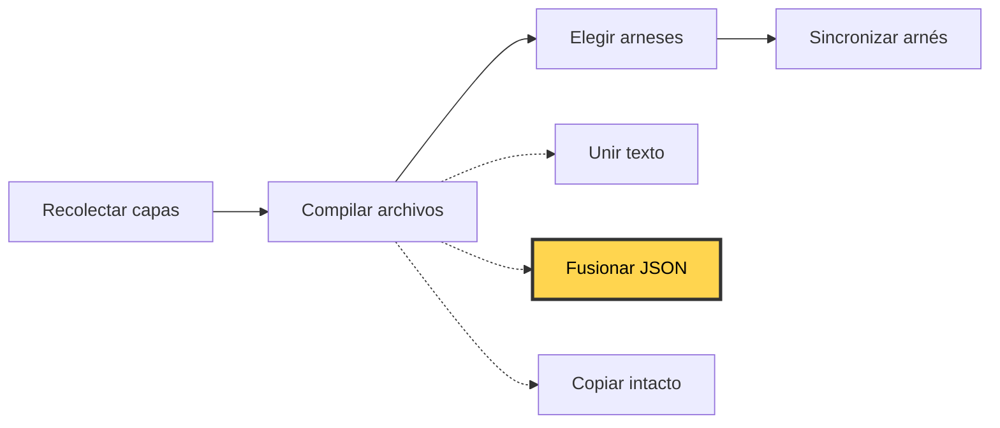
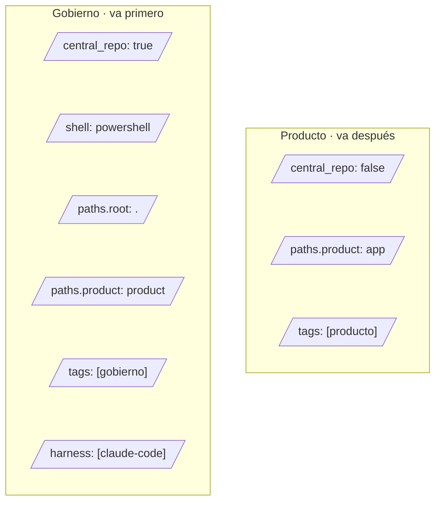
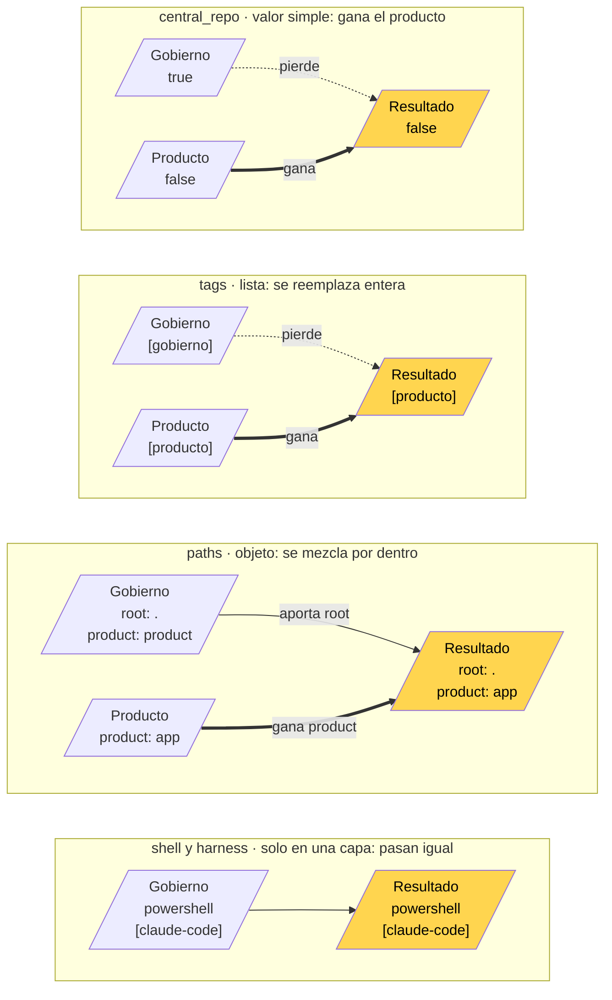
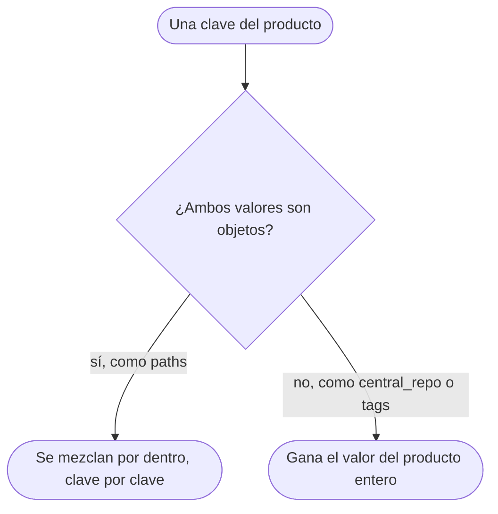
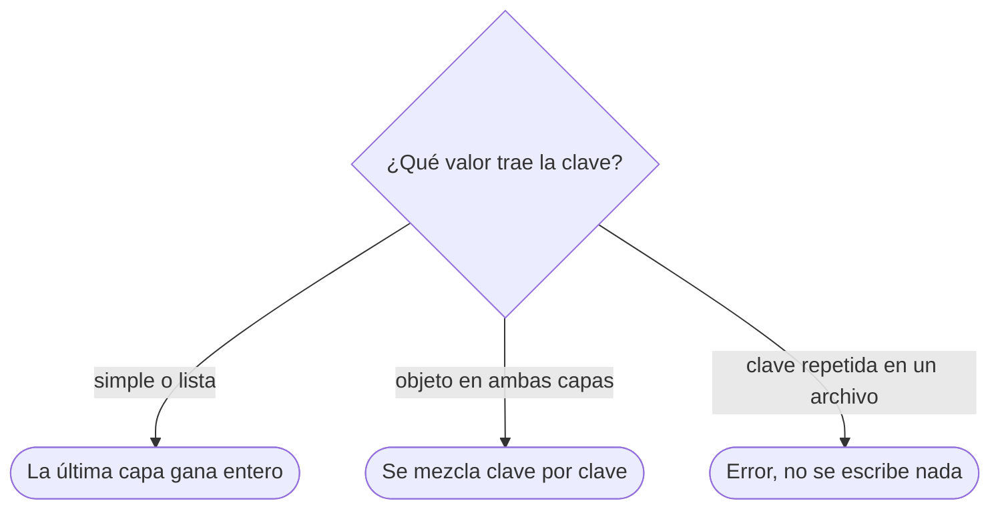
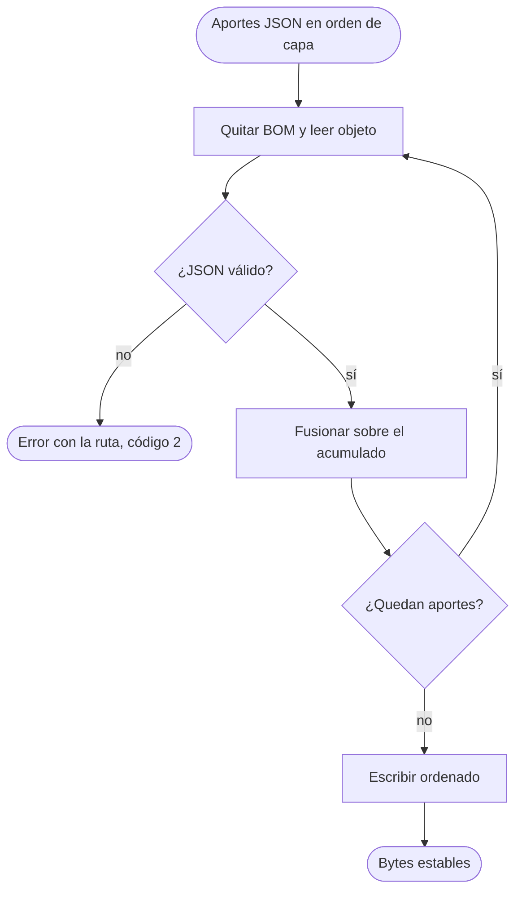

---
sources:
  - tools/internal/canon/compile.go
  - tools/internal/canon/io.go
verified: 018d405
---

# Fusionar JSON

> **En una frase.** Cuando dos [capas](../../GLOSSARY.md) traen el mismo `settings.json`, `canonc` los combina en el único archivo de configuración que recibe cada [arnés](../../GLOSSARY.md): el producto gana donde chocan, salvo dentro de objetos, que se mezclan clave por clave.

## Estás aquí



- [Recolectar capas](recolectar-capas.md): arma los grupos.
- [Compilar archivos](compilar-archivos.md): manda aquí los grupos `.json`.
- [Unir texto](unir-texto.md): el camino de los `.md` y `.txt`.
- [Fusionar JSON](fusionar-json.md): esta página.
- [Copiar intacto](compilar-archivos.md#copiar-intacto): el camino de las skills.
- [Elegir arneses](elegir-arneses.md): lee el JSON que sale de aquí.
- [Sincronizar arnés](sincronizar-arnes.md): escribe en `.claude/`.

## Lo que ya sabes

[Compilar archivos](compilar-archivos.md) mandó aquí el grupo `config/settings.json`, con dos [aportes](../../GLOSSARY.md): uno del gobierno y otro del producto. Pegarlos uno debajo del otro daría un JSON roto, así que hay que combinarlos.

## Entrada

Los dos archivos del [caso conductor](caso-conductor.md). El gobierno va primero y el producto después:



## Resultado

Cada clave de `.claude/aquas/settings.json`, una fila por caso. A la izquierda, lo que trae cada capa; a la derecha, lo que queda:



El producto gana porque va después. La excepción es `paths`: es un objeto en las dos capas, así que se mezcla por dentro y `root` se conserva. Archivo real del paso 1:

```json
{
  "central_repo": false,
  "harness": [
    "claude-code"
  ],
  "paths": {
    "product": "app",
    "root": "."
  },
  "shell": "powershell",
  "tags": [
    "producto"
  ]
}
```

## Fusionar en profundidad

La regla que produce ese resultado se llama **fusionar en profundidad**. Para cada clave del producto, `canonc` mira si los dos valores son objetos:



Se diseñó así para que el producto pueda **cambiar un detalle sin reescribir todo**. En el caso conductor, el producto cambió solo `paths.product` y no tuvo que copiar `paths.root`.

## Cuándo se detiene

Si un archivo repite una clave, `canonc` no elige uno de los dos valores. Nombra el archivo culpable, sale con código 2 y no escribe nada en `.claude/`. Paso 6 del caso conductor:

```text
> canonc -root compilacion-del-canon
error: .product-governance/config/settings.json: JSON inválido: jsontext: duplicate object member name "central_repo"
código de salida: 2
```

## Síntesis



La última capa gana, salvo dentro de objetos, donde se mezcla. Si el JSON es ambiguo, `canonc` se detiene. Una consecuencia directa: si el producto declara `"harness"`, su lista reemplaza entera la del gobierno; el paso 7 del caso conductor lo muestra.

<details>
<summary><strong>Detalle completo</strong> (para quien va a cambiar el código)</summary>

**Funciones:** `mergeJSON` y `deepMerge` en `tools/internal/canon/compile.go`; `decodeObject` y `encodeObject` en `tools/internal/canon/io.go`.

**Qué cuenta como entrada válida**
- Un archivo vacío o con `null` cuenta como objeto vacío.
- Se quita la marca BOM antes de leer, porque algunos editores de Windows la agregan.
- Una clave repetida es error, porque `encoding/json/v2` la rechaza.
- El mensaje de error trae la ruta del archivo culpable.

**Cómo se escribe el resultado**
- Las claves van en orden alfabético (`json.Deterministic(true)`), con sangría de dos espacios y un salto de línea al final.
- Ordenar importa porque `canonc -check` compara bytes. En Go, un mapa no tiene orden fijo, así que sin ordenar el mismo JSON podría salir distinto en cada ejecución y parecer «desactualizado».

**Recorrido completo**



- [Quitar BOM y leer objeto](#cuándo-se-detiene): `decodeObject`; es donde falla una clave repetida.
- [Fusionar sobre el acumulado](#fusionar-en-profundidad): `deepMerge`.
- [Escribir ordenado](#resultado): `encodeObject`; produce el JSON que se ve en Resultado.

</details>

**Siguiente:** [Elegir arneses](elegir-arneses.md). Lee la lista `harness` de este JSON ya fusionado.
