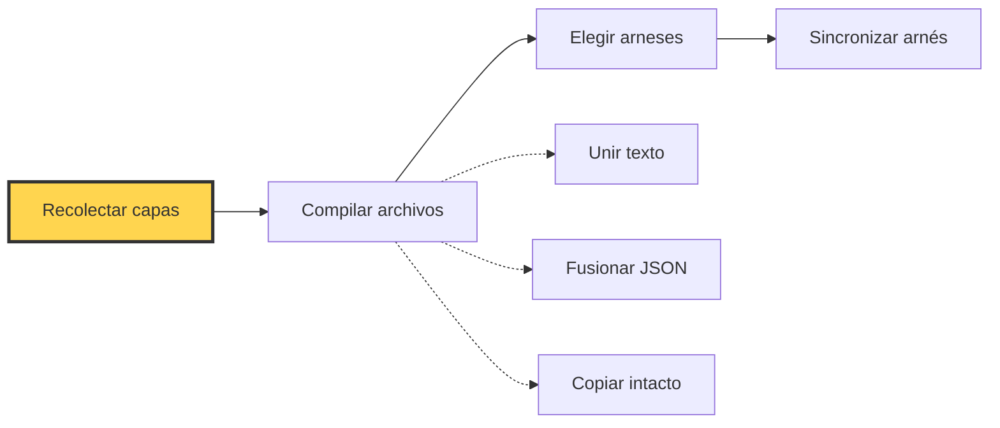
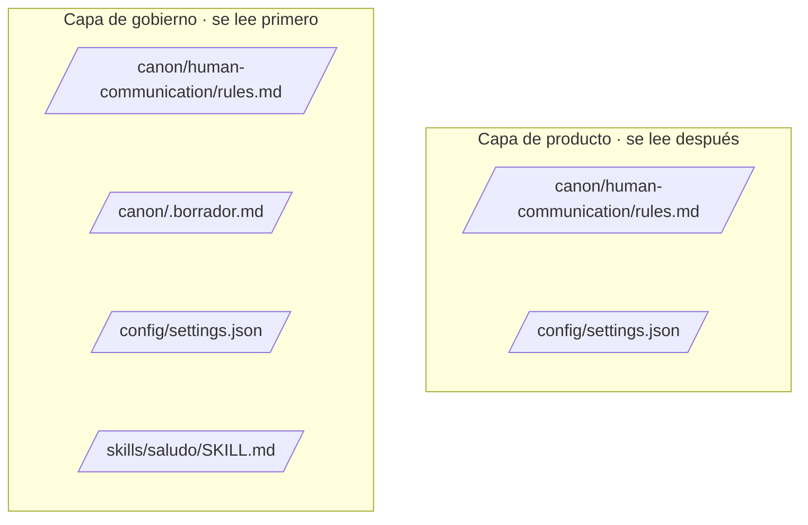
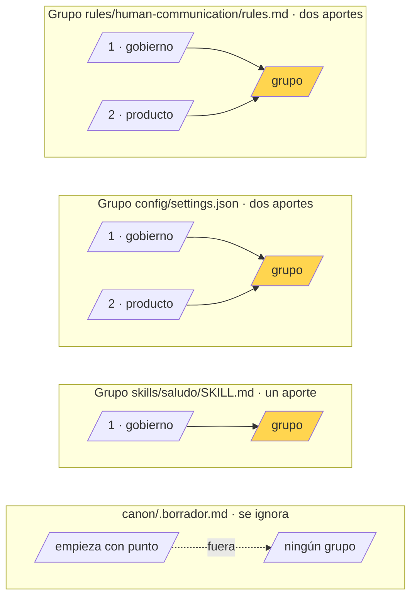
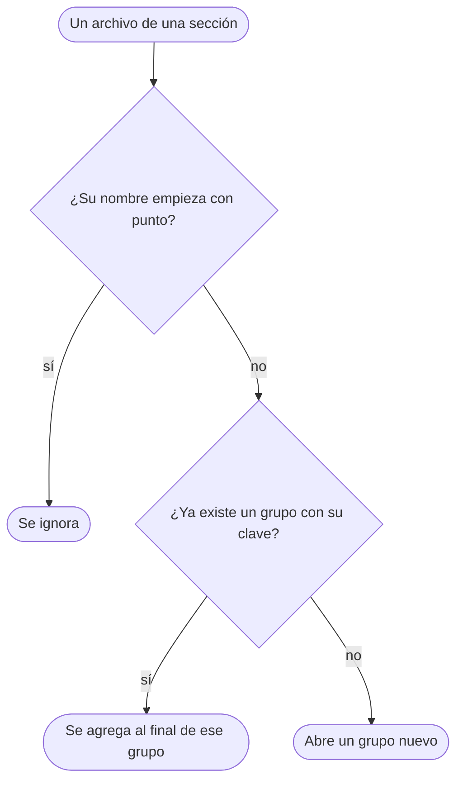
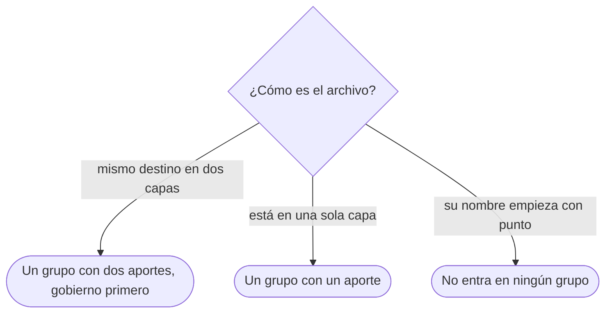
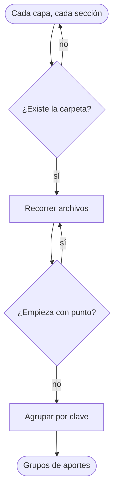

---
sources:
  - tools/internal/canon/compile.go
verified: 018d405
---

# Recolectar capas

> **En una frase.** `canonc` recorre cada [capa](../../GLOSSARY.md) en orden y junta en un grupo los archivos que terminarán en el mismo lugar de cada [arnés](../../GLOSSARY.md), con lo del gobierno siempre antes que lo del producto.

## Estás aquí



- [Recolectar capas](recolectar-capas.md): esta página.
- [Compilar archivos](compilar-archivos.md): recibe los grupos que salen de aquí.
- [Unir texto](unir-texto.md): une reglas en Markdown.
- [Fusionar JSON](fusionar-json.md): fusiona configuración.
- [Copiar intacto](compilar-archivos.md#copiar-intacto): copia skills.
- [Elegir arneses](elegir-arneses.md): lee a qué arneses escribir.
- [Sincronizar arnés](sincronizar-arnes.md): escribe en `.claude/`.

## Lo que ya sabes

En el [caso conductor](caso-conductor.md) hay dos `rules.md` en carpetas distintas que deben terminar en un solo archivo. Antes de unirlos, `canonc` necesita saber que son «el mismo archivo» y en qué orden van. Esta es la primera caja del mapa: todavía no une nada, solo ordena.

## Entrada

Cada capa tiene hasta tres subcarpetas. A cada una la llamamos **[sección](../../GLOSSARY.md)**: `canon` (las reglas del [canon](../../GLOSSARY.md)), `config` (configuración) y `skills`. En el caso conductor:



## Resultado

Tres grupos, uno por archivo de salida. Lo que cada capa trae para un mismo grupo es un **[aporte](../../GLOSSARY.md)**; dentro de cada grupo, el aporte del gobierno va primero. El archivo oculto no entra en ninguno:



En el paso 1 del caso conductor, la salida `(governance + product)` nombra justo esos aportes, en ese orden.

## Agrupar por clave

El mecanismo se llama **agrupar por clave**. Cada archivo recibe una clave: el tipo de su sección más su ruta dentro de ella. La sección `canon` da el tipo `rules`, así que `canon/human-communication/rules.md` de cualquier capa da la clave `rules/human-communication/rules.md`:



Se diseñó así para que el orden de los aportes salga del orden de lectura, sin ordenar nada después: como el gobierno se lee primero, su aporte siempre queda antes que el del producto.

## Cuándo se detiene

Si al terminar no hay ningún grupo, `canonc` sale con código 2. Casi siempre significa que `-root` apunta a la carpeta equivocada. Paso 8 del caso conductor:

```text
> canonc -root vacio
error: no encontré archivos en "vacio": revisa -root
código de salida: 2
```

## Síntesis



Recolectar no combina nada: solo decide qué va junto y en qué orden. Una consecuencia directa: para que el producto agregue reglas a un archivo del gobierno, basta con crear un archivo con la misma ruta dentro de su sección.

<details>
<summary><strong>Detalle completo</strong> (para quien va a cambiar el código)</summary>

**Función:** `collect` en `tools/internal/canon/compile.go`. Las tablas `layers` y `sections` del mismo archivo fijan el orden.

**Orden de lectura:** gobierno y luego producto; dentro de cada capa, `canon`, `config` y `skills`.

**Casos límite**
- Una sección que no existe se salta sin error.
- Un archivo o una carpeta cuyo nombre empieza con punto se ignora, para no recoger archivos ocultos del editor. La regla aplica al nombre de cada archivo, no a la ruta completa.
- Cualquier otro error al leer una sección detiene todo con su ruta.
- `Run` es quien da el error de «no encontré archivos», cuando `collect` devuelve cero grupos.

**Recorrido completo**



- [Recorrer archivos](#entrada): `fs.WalkDir` sobre cada sección.
- [Agrupar por clave](#agrupar-por-clave): la sección de arriba.

</details>

**Siguiente:** [Compilar archivos](compilar-archivos.md). Recibe estos tres grupos y decide cómo combinar cada uno.
