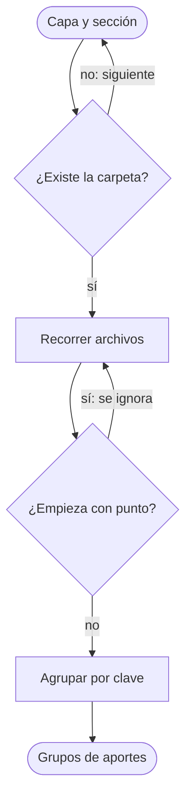

---
sources:
  - tools/internal/canon/compile.go
verified: 74eb64a
---

# Recolectar capas

> **Resumen.** Primer [proceso](../../GLOSSARY.md) de la [Compilación del canon](README.md). Recorre cada [capa](../../GLOSSARY.md) en orden y agrupa, por archivo de salida, lo que trae cada una. No une nada todavía: solo arma la lista de [aportes](../../GLOSSARY.md) en el orden correcto. Función: `collect` en `compile.go`.

## Para qué sirve
En el [caso conductor](caso-conductor.md), dos archivos `rules.md` viven en carpetas distintas pero deben terminar en uno solo. Antes de unirlos hay que saber que son «el mismo archivo» y en qué orden van.

## Qué necesitas saber antes
- [Compilación del canon](README.md): los términos canon, capa, [sección](../../GLOSSARY.md) y [arnés](../../GLOSSARY.md).

## Cómo funciona
¿Cómo sabe `canonc` que dos archivos de distintas [capas](../../GLOSSARY.md) son el mismo? Recorre cada [sección](../../GLOSSARY.md) de cada capa y los agrupa por su clave:

- [Recorrer archivos](#recorrer-archivos): lee cada archivo de la sección.
- [Agrupar por clave](#agrupar-por-clave): junta en un grupo los archivos que van al mismo destino.

### Recorrer archivos
¿Qué se lee? Todo archivo dentro de `canon/`, `config/` o `skills/` de cada capa, en este orden: gobierno y luego producto; dentro de cada capa, `canon`, `config`, `skills`. Una carpeta que no existe se salta sin error. Un archivo o carpeta cuyo nombre empieza con punto se ignora, para no recoger archivos ocultos del editor.

En el caso conductor se leen cinco archivos: dos `rules.md`, dos `settings.json` y un `SKILL.md`.

### Agrupar por clave
¿Cómo se juntan? Cada archivo recibe una clave formada por su tipo y su ruta dentro de la sección. `canon/human-communication/rules.md` de cualquier capa da la clave `rules/human-communication/rules.md`. Si la clave ya existe, el archivo se agrega como un **aporte** más al final del grupo; si no, se abre un grupo nuevo.

A esa lista ordenada de lo que cada capa trae para un mismo destino la llamamos [aporte](../../GLOSSARY.md). Como el gobierno se recorre primero, su aporte siempre va antes que el del producto: así se garantiza que el producto tenga la palabra final sin ordenar nada después.

Si al terminar no hay ningún grupo, `canonc` sale con error: casi siempre significa que `-root` apunta a la carpeta equivocada.

Siguiente proceso: [Compilar archivos](compilar-archivos.md).
