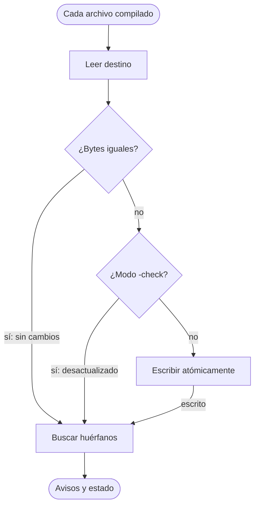

---
sources:
  - tools/internal/canon/compile.go
  - tools/internal/canon/io.go
verified: 74eb64a
---

# Sincronizar arnés

> **Resumen.** Último [proceso](../../GLOSSARY.md) de la [Compilación del canon](README.md). Para cada [arnés](../../GLOSSARY.md), compara cada archivo compilado con el que ya está en disco y escribe solo los que cambiaron, de forma atómica. Con `-check` no escribe: solo marca los desactualizados. Al final avisa de los archivos que nadie declaró ([huérfanos](../../GLOSSARY.md)). Funciones: `sync` y `orphans` en `compile.go`; `writeFileAtomic` en `io.go`.

## Para qué sirve
En el paso 4 del [caso conductor](caso-conductor.md), solo cambió la regla del producto: se reescribió un archivo y los otros dos quedaron `sin cambios`. Escribir solo lo necesario hace que `-check` sea confiable y que git muestre únicamente cambios reales.

## Qué necesitas saber antes
- [Compilar archivos](compilar-archivos.md): de ahí salen los bytes finales.
- [Elegir arneses](elegir-arneses.md): de ahí salen las carpetas de destino.

## Cómo funciona
¿Qué pasa con cada archivo compilado? Se compara antes de tocar el disco:

- [Leer destino](#leer-destino): busca el archivo actual en `.claude/`.
- [Escribir atómicamente](#escribir-atómicamente): escribe sin dejar archivos a medias.
- [Buscar huérfanos](#buscar-huérfanos): avisa de lo que sobra, cuando ya se procesaron todos.

### Leer destino
¿Contra qué se compara? Contra el archivo en la carpeta del arnés, por ejemplo `.claude/rules/human-communication/rules.md`. Si no existe, cuenta como diferente. Si existe y sus bytes son idénticos, se imprime `sin cambios` y no se toca. Cualquier otro error de lectura se acumula y termina en código 2.

### Escribir atómicamente
¿Cómo se evita que Claude Code lea un archivo a medio escribir? Se escribe primero `<archivo>.tmp` y luego se renombra sobre el destino; el renombre es instantáneo. Si el renombre falla, se borra el temporal. Las carpetas que faltan se crean. Tras escribir se imprime `escrito` con las [capas](../../GLOSSARY.md) que aportaron, por ejemplo `(governance + product)`.

Una aclaración honesta: un error de escritura a mitad de la sincronización sí puede dejar algunos archivos ya actualizados y otros no. La garantía de «no escribe nada» cubre los errores de leer, compilar y elegir arneses, que ocurren antes.

### Buscar huérfanos
¿Qué pasa con un archivo de `.claude/rules` que ninguna capa produce? Se imprime un aviso y se deja donde está. A ese archivo lo llamamos [huérfano](../../GLOSSARY.md). Solo se revisan las carpetas que el compilador maneja (`.claude/rules`, `.claude/skills`, `.claude/aquas`); el resto de `.claude/`, como `.claude/settings.json`, no se mira. En el paso 4 del caso conductor, `viejo.md` generó el aviso y `canonc` igual salió con código 0.

### El estado final
Si algún archivo difería, el resultado queda marcado como desactualizado. Con `-check`, eso hace que `main` salga con código 1 y el mensaje «el arnés está desactualizado: ejecuta canonc sin -check». Sin `-check`, los archivos ya se escribieron y la salida es 0.
