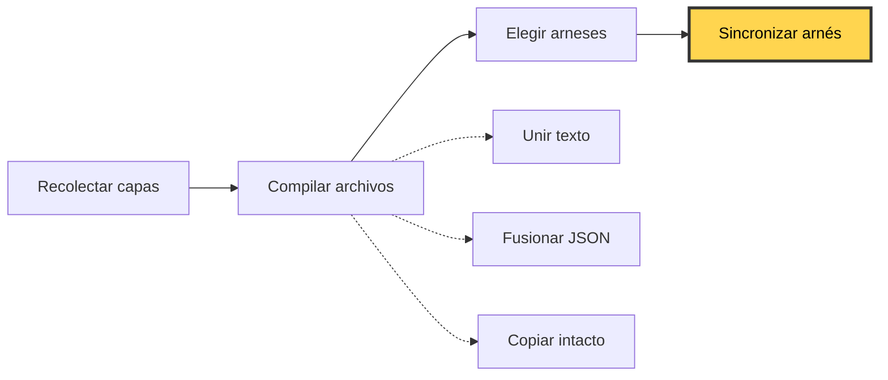
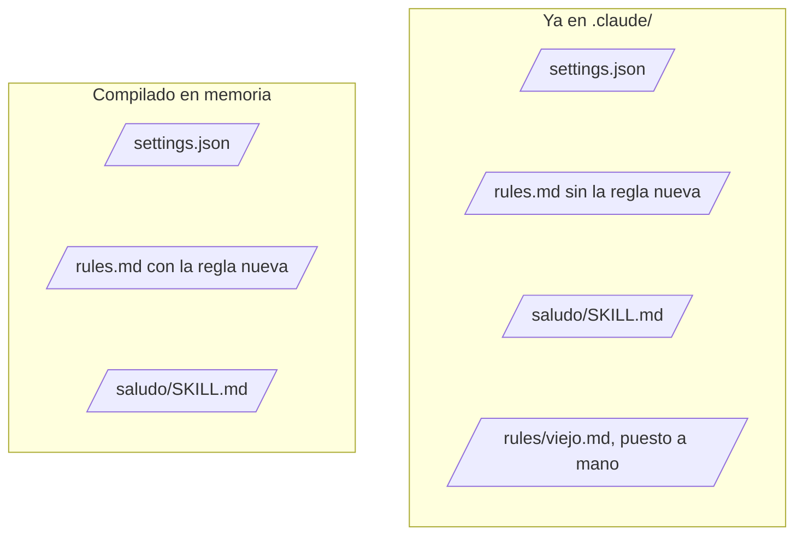
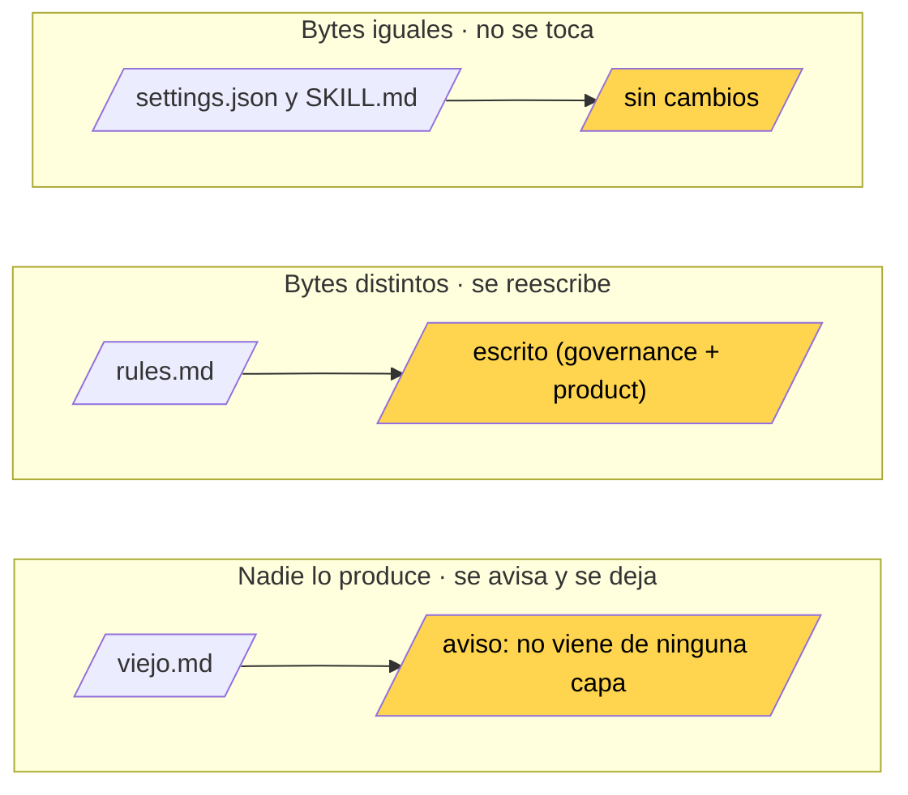
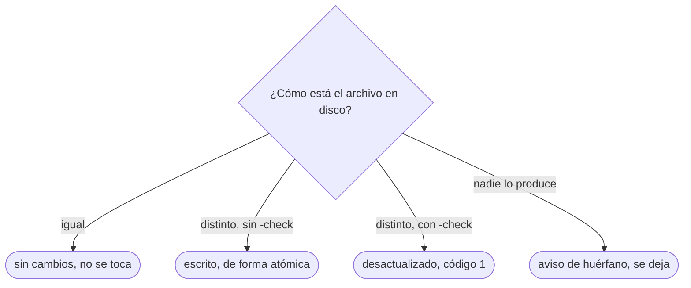

---
sources:
  - tools/internal/canon/compile.go
  - tools/internal/canon/io.go
verified: 018d405
---

# Sincronizar arnés

> **En una frase.** Para cada [arnés](../../GLOSSARY.md), `canonc` toma lo que compiló de todas las [capas](../../GLOSSARY.md), lo compara cada archivo compilado con el que ya está en disco y escribe solo los que cambiaron; con `-check` no escribe nada y solo los marca.

## Estás aquí



- [Recolectar capas](recolectar-capas.md): arma los grupos.
- [Compilar archivos](compilar-archivos.md): produce el contenido de cada archivo.
- [Unir texto](unir-texto.md): reglas en Markdown.
- [Fusionar JSON](fusionar-json.md): configuración.
- [Copiar intacto](compilar-archivos.md#copiar-intacto): skills.
- [Elegir arneses](elegir-arneses.md): da las carpetas de destino.
- [Sincronizar arnés](sincronizar-arnes.md): esta página, la única que escribe en disco.

## Lo que ya sabes

Hasta aquí todo ocurrió en memoria: [Compilar archivos](compilar-archivos.md) dejó el contenido final de cada archivo y [Elegir arneses](elegir-arneses.md) dejó sus carpetas. Esta es la última caja y la única que toca `.claude/`.

## Entrada

Por cada archivo, dos versiones: la que acaba de compilarse y la que ya está en disco. En el paso 4 del [caso conductor](caso-conductor.md), después de que el producto agregó una regla:



## Resultado

Un bloque por situación. Cada uno muestra la línea real que imprimió `canonc`:



Salida real del paso 4:

```text
> canonc -root compilacion-del-canon
sin cambios     .claude/aquas/settings.json
escrito         .claude/rules/human-communication/rules.md  (governance + product)
sin cambios     .claude/skills/saludo/SKILL.md
aviso: .claude/rules/viejo.md no viene de ninguna capa; revísalo o bórralo
código de salida: 0
```

`viejo.md` es un **[huérfano](../../GLOSSARY.md)**: un archivo de las carpetas del arnés que ninguna capa produce.

## Comparar antes de escribir

El mecanismo compara bytes antes de tocar el disco. Si son iguales, no escribe; si difieren, escribe o, con `-check`, solo marca:


- [Leer destino](#comparar-antes-de-escribir): un destino que no existe cuenta como distinto.
- [Escribir atómicamente](#escribir-atómicamente): escribe sin dejar archivos a medias.
- [Buscar huérfanos](#resultado): se hace una sola vez, después de todos los archivos.

Se diseñó así para que `-check` sea confiable y para que git solo muestre cambios reales: un archivo que no cambió no se reescribe.

### Escribir atómicamente

Primero se escribe `<archivo>.tmp` y luego se renombra sobre el destino; el renombre es instantáneo. Así Claude Code nunca lee un archivo a medio escribir. Si el renombre falla, se borra el temporal.

## Cuándo se detiene

Con `-check`, un archivo distinto hace que `canonc` salga con código 1, sin escribir nada. Paso 3 del caso conductor:

```text
> canonc -root compilacion-del-canon -check
sin cambios     .claude/aquas/settings.json
desactualizado  .claude/rules/human-communication/rules.md
sin cambios     .claude/skills/saludo/SKILL.md
el arnés está desactualizado: ejecuta canonc sin -check
código de salida: 1
```

Un error al leer o escribir un archivo termina en código 2. A diferencia de los errores en memoria, este sí puede dejar algunos archivos ya actualizados y otros no.

## Síntesis



Sincronizar escribe solo lo que cambió y nunca borra. Una consecuencia directa: ejecutar `canonc` dos veces seguidas no cambia nada la segunda vez, como muestra el paso 2 del caso conductor.

<details>
<summary><strong>Detalle completo</strong> (para quien va a cambiar el código)</summary>

**Funciones:** `sync` y `orphans` en `tools/internal/canon/compile.go`; `writeFileAtomic` en `tools/internal/canon/io.go`.

- `sync` recorre los archivos en orden alfabético de clave e imprime una línea por archivo.
- Un error de lectura que no sea «no existe» se acumula y termina en código 2.
- `writeFileAtomic` crea las carpetas que faltan con `MkdirAll` antes de escribir.
- `orphans` solo revisa las carpetas que maneja el compilador (`.claude/rules`, `.claude/skills`, `.claude/aquas`); el resto de `.claude/`, como `.claude/settings.json`, no se mira. No ignora archivos que empiezan con punto.
- `main` traduce el estado: con `-check` y algún archivo distinto, código 1 y el mensaje «el arnés está desactualizado»; sin `-check`, código 0 tras escribir.

</details>

**Siguiente:** [Compilación del canon](README.md). Vuelve a la vista completa.
