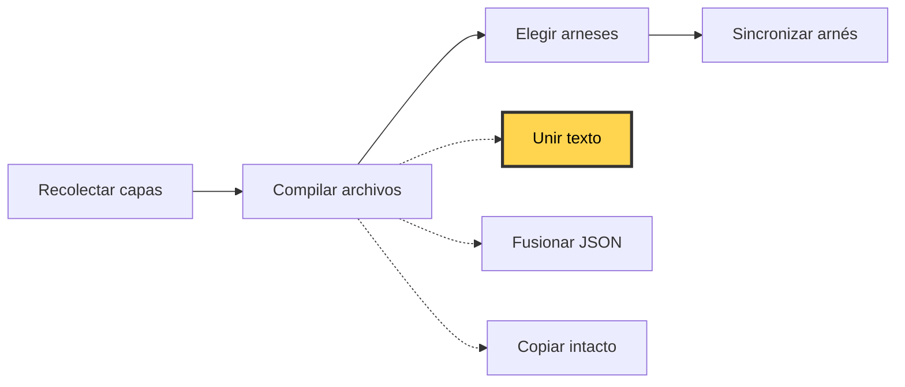
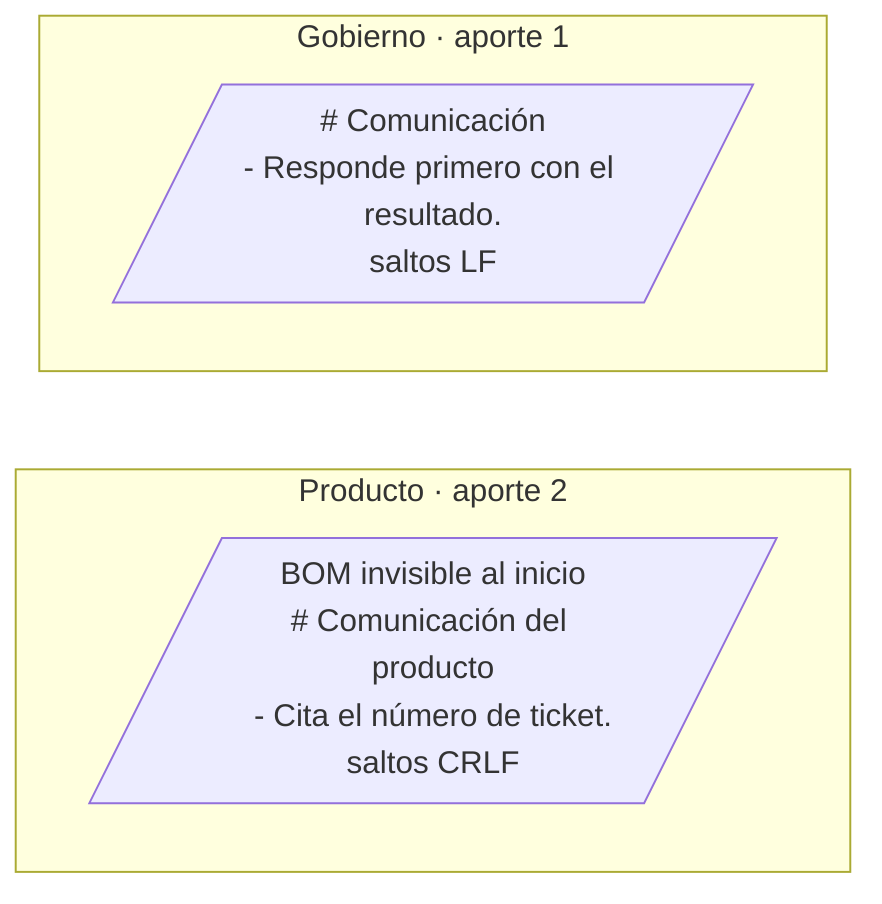
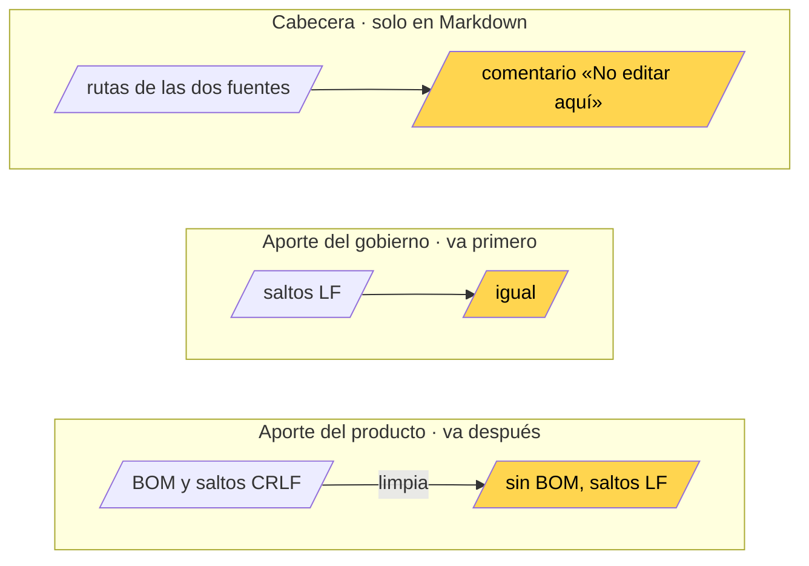
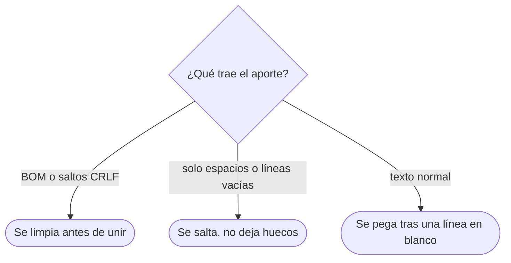

---
sources:
  - tools/internal/canon/compile.go
verified: 018d405
---

# Unir texto

> **En una frase.** Para un archivo `.md` o `.txt`, `canonc` limpia cada [aporte](../../GLOSSARY.md) y los pega en orden de [capa](../../GLOSSARY.md), con una línea en blanco entre ellos; en Markdown agrega arriba un aviso para que nadie edite la copia que lee el [arnés](../../GLOSSARY.md).

## Estás aquí



- [Recolectar capas](recolectar-capas.md): arma los grupos.
- [Compilar archivos](compilar-archivos.md): manda aquí los grupos `.md` y `.txt`.
- [Unir texto](unir-texto.md): esta página.
- [Fusionar JSON](fusionar-json.md): el camino de los `.json`.
- [Copiar intacto](compilar-archivos.md#copiar-intacto): el camino de las skills.
- [Elegir arneses](elegir-arneses.md): lee a qué arneses escribir.
- [Sincronizar arnés](sincronizar-arnes.md): escribe en `.claude/`.

## Lo que ya sabes

[Compilar archivos](compilar-archivos.md) mandó aquí el grupo `rules/human-communication/rules.md`, con dos aportes: el del gobierno y el del producto. El del producto se escribió en un editor de Windows, que agrega marcas invisibles.

## Entrada

Los dos aportes del [caso conductor](caso-conductor.md), con lo que no se ve a simple vista. Los saltos de línea de Linux y macOS son `\n` (LF); los de Windows son `\r\n` (CRLF):



## Resultado

Un solo archivo, limpio, con el aviso arriba:



Archivo real del paso 1, `.claude/rules/human-communication/rules.md`:

```markdown
<!-- Generado por canonc desde .aquas-governance/canon/human-communication/rules.md + .product-governance/canon/human-communication/rules.md. No editar aquí: edita las fuentes. -->

# Comunicación
- Responde primero con el resultado.

# Comunicación del producto
- Cita el número de ticket.
```

## Normalizar y unir

El mecanismo tiene dos partes. **Normalizar** limpia cada aporte: quita la marca BOM del inicio, cambia `\r\n` por `\n` y recorta los espacios y líneas vacías del final. **Unir** pega los aportes limpios con exactamente una línea en blanco entre ellos y un salto de línea al final:


- [Escribir cabecera](#escribir-cabecera): avisa de qué fuentes salió el archivo.
- [Normalizar texto](#normalizar-y-unir): limpia cada aporte.
- [Agregar con separación](#normalizar-y-unir): pega el aporte con una línea en blanco.

Se diseñó así porque, sin normalizar, la unión dejaría un BOM a mitad de archivo y mezclaría tipos de salto de línea. Además, `canonc -check` compara bytes: el mismo texto debe dar siempre los mismos bytes.

### Escribir cabecera

En Markdown, la primera línea es un comentario HTML con las rutas de todas las fuentes. Al ser un comentario, Claude Code y GitHub no lo muestran como texto, pero quien abre el archivo ve que no debe editarlo. En `.txt` no hay cabecera, porque un `.txt` no tiene comentarios.

## Síntesis



El resultado es el texto de cada capa, limpio y en orden, separado por una línea en blanco. Una consecuencia directa: da igual en qué editor o sistema escriba cada capa; `.claude/` siempre recibe el mismo formato.

<details>
<summary><strong>Detalle completo</strong> (para quien va a cambiar el código)</summary>

**Funciones:** `concatText` y `normalizeText` en `tools/internal/canon/compile.go`.

- `normalizeText` es una [hoja](../../GLOSSARY.md): quita el BOM con `bytes.TrimPrefix`, reemplaza `\r\n` por `\n` y recorta al final espacios, tabuladores y saltos (`" \t\n"`). No toca el inicio del texto ni un `\r` suelto.
- `concatText` escribe la cabecera solo si la extensión es `.md`, y usa las rutas de `part.src` unidas con `" + "`.
- Un aporte vacío tras normalizar se salta; si todos quedan vacíos, el archivo es la cabecera (en `.md`) y un salto de línea.
- El paso 3 del caso conductor mezcla `\r\n` y `\n` en el mismo archivo del producto; el paso 4 lo compila y el resultado solo tiene `\n`.

</details>

**Siguiente:** [Fusionar JSON](fusionar-json.md). Lo que le pasa al grupo de configuración.
