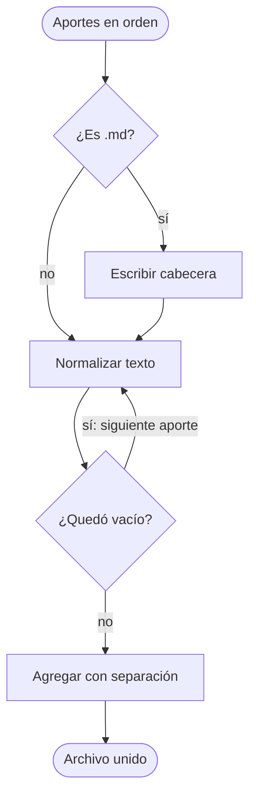

---
sources:
  - tools/internal/canon/compile.go
verified: 74eb64a
---

# Unir texto

> **Resumen.** Parte de [Compilar archivos](compilar-archivos.md). Concatena los [aportes](../../GLOSSARY.md) de un archivo `.md` o `.txt` en orden de [capa](../../GLOSSARY.md), con una línea en blanco entre ellos. En Markdown antepone un comentario que dice de dónde salió y que no se edite. Funciones: `concatText` y `normalizeText` en `compile.go`.

## Para qué sirve
En el [caso conductor](caso-conductor.md), la regla del gobierno y la del producto deben quedar en un solo `rules.md`, en ese orden, sin marcas raras de los editores de Windows en medio.

## Qué necesitas saber antes
- [Compilar archivos](compilar-archivos.md): por qué este grupo llegó aquí y no a copiar o fusionar.

## Cómo funciona
¿Cómo se pegan dos textos sin dejar basura entre ellos? Cada aporte se limpia antes de agregarse:

- [Escribir cabecera](#escribir-cabecera): avisa de qué fuentes salió el archivo.
- [Normalizar texto](#normalizar-texto): limpia cada aporte.
- [Agregar con separación](#agregar-con-separación): pega el aporte con una línea en blanco.

### Escribir cabecera
¿Cómo sabe quien abre `.claude/rules/...` que no debe editarlo? En Markdown, la primera línea es un comentario HTML con las rutas de todas las fuentes. En el caso conductor: `<!-- Generado por canonc desde ...rules.md + ...rules.md. No editar aquí: edita las fuentes. -->`. Al ser un comentario, Claude Code y GitHub no lo muestran como texto.

### Normalizar texto
¿Qué se limpia? Tres cosas: la marca BOM que algunos editores de Windows ponen al inicio, los saltos de línea `\r\n` (pasan a `\n`) y los espacios y líneas vacías al final. Sin esto, la unión dejaría un BOM a mitad de archivo y mezclaría tipos de salto de línea. Es una [hoja](../../GLOSSARY.md): una sola función, sin decisiones.

### Agregar con separación
¿Qué separa a dos aportes? Exactamente una línea en blanco. Un aporte que quedó vacío tras normalizar se salta, para no dejar líneas sobrantes. Al final se agrega un salto de línea. En el caso conductor, `- Responde primero con el resultado.` y `# Comunicación del producto` quedan separados por una línea en blanco.
